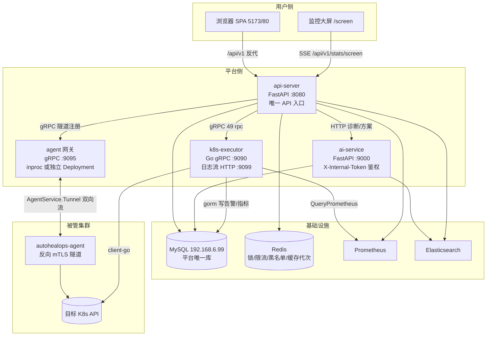

# 01 · 项目总览（Project Overview）

> 审计类型：只读代码审计（未修改任何业务代码/配置/依赖，未连接生产，未执行 git 写操作）
> 仓库：`/Users/wolf/Documents/project/autohealops`　分支：`main`
> 审计时点：2026-11-27，HEAD = `b3b9f03`（2026-11-27 09:22 +0800）

---

## 1. 结论摘要

1. **项目是「多 K8s 集群管理 + AI 诊断自愈」平台的单体多服务实现**，4 个自研服务 + 1 个被管集群 Agent，全部代码约 **16.1 万行**（不含 `node_modules`/`.venv`/`dist`）。
2. **重量严重不均**：`api-server` 是绝对主体，**495 个源码文件 / 88178 行**，其中 `app/services` 就有 **114 个模块 / 39935 行**、`app/api` **67 个模块 / 19176 行**；`ai-service` 仅 47 文件 / 5971 行，`k8s-executor` 78 文件 / 28750 行，前端 148 文件 / 35102 行。
3. **单一入口架构成立且代码可验证**：`api-server` 注册了 **66 个 APIRouter 模块**（`api-server/app/main.py:672-737`），是唯一对外 API；对 executor 走 gRPC 9090，对 ai-service 走 HTTP 9000 且带 `X-Internal-Token` 内部鉴权（`ai-service/app/main.py:44-49`）。
4. **数据层只有一个平台库（MySQL）+ Redis**：`DATABASE_URL=mysql+aiomysql://...`（`.env.example:7`），Redis 用于锁/限流/黑名单/缓存代次（`api-server/app/core/redis_client.py:3-4`）；`k8s-executor` 也直连同一 MySQL 写告警（`k8s-executor/internal/database/db.go:18-19`、`internal/watcher/sink.go:215`），并非「只有 api-server 碰库」。
5. **没有消息队列**：全仓库无 Kafka/RabbitMQ/RocketMQ/Celery 客户端依赖，只有监控指标名里出现 `rocketmq_*`/`rabbitmq_*`（`api-server/app/services/resource_alert_service.py:75-79`，属「监控别的 MQ」而非自用）。
6. **数据库迁移链很长但健康**：`api-server/alembic/versions` 共 **123 个 revision 文件**，静态解析为**单一 head `r81a1b2c3d4e5`**（`add_slow_sql_full_text.py`），无分叉。
7. **测试覆盖失衡**：`api-server` 97 个 unittest 文件、`ai-service` 14 个、`k8s-executor` 12 个 `_test.go`（28.7k 行 Go 只有 12 个测试文件），**前端 0 测试框架**（`frontend/package.json:6-10` 无 test 脚本）。
8. **部署有三条路径但 `docker-compose.yml` 与代码不同步**：见问题 OPS-01（executor 日志流 9099 未暴露/未注入），Docker 模式下实时日志跟随会指向容器内 localhost。

---

## 2. 项目定位

- 自述定位：「多 Kubernetes 集群管理 + AI 智能诊断自愈平台……经决策审批后自动执行修复，全链路审计可追溯」（`README.md:3`）。
- 服务分工（`README.md:39-41`）：
  - **api-server**：系统大脑和门面，全部业务逻辑，唯一对外 API 入口；
  - **k8s-executor**：系统的手和眼睛，K8s 交互、watch 故障检测、命令执行；
  - **ai-service**：AI 大脑，诊断/方案生成/多模型协同；
  - **agent**：被管集群内的反向隧道客户端（`agent/README.md:20-32`），源码在 `k8s-executor/cmd/agent`。
- 代码可佐证的业务域：集群纳管、资源查询/操作、告警与自愈、AI 诊断与处置、主机 SSH 纳管、数据库纳管与慢 SQL 诊断、工单/审批、审计哈希链、通知（钉钉/企微/飞书）、知识库 RAG、发布（Jenkins）、监控大屏。

---

## 3. 代码规模统计

统计口径（排除虚拟环境/依赖/构建产物）：

```bash
# 分目录文件数与 LOC（源码类扩展名）
for d in api-server ai-service k8s-executor frontend agent scripts templates k8s docs; do
  echo -n "$d: files="
  find $d -type f \( -name '*.py' -o -name '*.go' -o -name '*.ts' -o -name '*.tsx' -o -name '*.sh' -o -name '*.sql' -o -name '*.yaml' -o -name '*.yml' \) \
    -not -path '*/node_modules/*' -not -path '*/.venv/*' -not -path '*/__pycache__/*' -not -path '*/dist/*' | wc -l
  find $d -type f \( -name '*.py' -o -name '*.go' -o -name '*.ts' -o -name '*.tsx' -o -name '*.sh' -o -name '*.sql' -o -name '*.yaml' -o -name '*.yml' \) \
    -not -path '*/node_modules/*' -not -path '*/.venv/*' -not -path '*/__pycache__/*' -not -path '*/dist/*' | xargs cat 2>/dev/null | wc -l
done
```

实测结果：

| 目录 | 源码文件数 | LOC（约） | 说明 |
|---|---:|---:|---|
| `api-server` | 495 | 88,178 | 含 `alembic/versions` 123 个迁移、`tests` 97 个 |
| ├ `api-server/app` | 258 | 68,888 | api 67 / services 114 / models 59 / core 9 / clients 3 |
| ├ `api-server/app/api` | 67 | 19,176 | 66 个路由模块 + `__init__` |
| ├ `api-server/app/services` | 114 | 39,935 | 业务逻辑主体，最大单体 `resources.py` 在 api 层 |
| └ `api-server/app/models` | 59 | 2,544 | 87 个 ORM 模型类 |
| `k8s-executor` | 78 | 28,750 | 19 个 internal 包 + cmd/executor + cmd/agent |
| `frontend` | 148 | 35,102 | `src` 下 ts/tsx：69 个页面文件（53 顶层 + 16 cluster）、56 个组件、4 个 service |
| `ai-service` | 47 | 5,971 | 23 个 service、2 个路由模块 |
| `scripts` | 18 | 1,439 | CI/备份/迁移/保留期脚本 |
| `k8s` | 15 | 987 | 部署清单（无 Helm chart） |
| `templates` | 6 | 117 | 提示词/文档模板样例 |
| `agent` | 0 | 0 | 仅 Dockerfile/Makefile/README/examples，Go 源码在 executor 模块内 |
| **合计（源码）** | **807** | **约 160,500** | 不含 `docs/*.md`（74 个 md，未计入 LOC） |

其他规模指标：

| 指标 | 数值 | 取证命令 |
|---|---:|---|
| APIRouter 模块数 | 66 | `grep -l "APIRouter(" api-server/app/api/*.py \| wc -l` |
| 后端路由注册数 | 66 个 include_router | `grep -c "app.include_router" api-server/app/main.py` → 66 |
| ORM 模型类 | 87 | `grep -rn "^class .*Base" api-server/app/models/*.py \| wc -l` |
| Alembic revision | 123 文件 / 1 个 head `r81a1b2c3d4e5` | 静态解析 `revision`/`down_revision`（未执行 alembic） |
| gRPC 方法（executor） | 49 个 rpc | `grep -c "^  rpc " k8s-executor/proto/executor.proto` |
| Python 单测文件 | 97（api-server）+ 14（ai-service） | `ls api-server/tests/test_*.py \| wc -l` |
| Go 测试文件 | 12 | `find k8s-executor -name "*_test.go" \| wc -l` |
| 前端测试 | 0 | `frontend/package.json` 无 test 脚本/依赖 |

---

## 4. 顶层目录职责

| 路径 | 职责（证据） |
|---|---|
| `api-server/` | FastAPI 主服务：认证、集群、资源、告警、审批、工单、审计、主机、数据库、统计（`app/main.py:672-737` 注册 66 个 router） |
| `ai-service/` | 模型适配与 AI 能力：`model_openai/model_deepseek/model_claude` + `model_adapter` 降级链、RAG、ES/Prometheus 客户端（`app/api/core_api.py`、`app/api/aux_api.py`） |
| `k8s-executor/` | Go gRPC 执行器 + Agent 共用模块：`internal/executor`（K8s 操作）、`watcher`（故障检测）、`agentbridge`（隧道转发）、`agentdb`（跨库查询）、`logstream`（9099 日志流） |
| `agent/` | Agent 构建物料（Dockerfile/Makefile/examples），源码在 `k8s-executor/cmd/agent`（`agent/README.md:22-32` 解释原因：Go internal 规则） |
| `frontend/` | React 18 + Ant Design 5 SPA，69 个页面文件、独立集群整页路由（`src/App.tsx:205-230`） |
| `k8s/` | 裸 YAML 部署清单（5 个 Deployment、Service、HPA/PDB/NetworkPolicy/Ingress、2 个 CronJob），无 Helm（`k8s/README.md`） |
| `scripts/` | `ci_check.sh`（8 步校验）、备份、分区检查、日志轮转、openapi 漂移检查 |
| `docs/` | 84 个条目、74 个 md，含架构/需求/运维/审计文档 |
| `templates/` | 提示词模板样例（`templates/README.md` + before/after/proposals/simple/tools） |
| `data/`, `logs/` | 运行期数据（agent CA、会话历史）与日志（`start.sh:26-27`） |

---

## 5. 服务与端口

| 服务 | 端口 | 证据 |
|---|---|---|
| frontend（Vite dev） | 5173 | `README.md:16`、`frontend/vite.config.ts:12` |
| frontend（nginx 生产） | 80 | `frontend/nginx.conf:2`、`docker-compose.yml:38` |
| api-server HTTP | 8080 | `start.sh:13`、`docker-compose.yml:12` |
| api-server → agent gRPC 网关 | 9095（同进程，inproc 模式） | `start.sh:13`、`api-server/app/core/config.py:86,100`、`app/main.py:551-557` |
| api-server → agent 网关（remote 模式） | 9096 内部地址 | `api-server/app/core/config.py:101` |
| ai-service | 9000 | `README.md:16`、`ai-service/Dockerfile:11` |
| k8s-executor gRPC | 9090 | `k8s-executor/Dockerfile:25`、`.env.example:52` |
| k8s-executor 日志流 HTTP | 9099 | `start.sh:15`、`api-server/app/core/config.py:39` |
| 平台自监控 `/metrics` | 8080/metrics | `api-server/app/main.py:631` |

> `start.sh` 明确要求 api-server 的 8080 与 9095 **必须是同一个 PID**，否则 agent 实时 RPC 会落到旧进程（`start.sh:101-116`，注释见 `:18-21`）；这是本项目已知的历史坑，脚本已做校验与强杀兜底。

---

## 6. 启动方式（读真实流程）

### 6.1 本地启动 `start.sh`（nohup 后台）

`start_all()` 顺序固定为 **executor → api-server → ai-service → frontend**（`start.sh:152-164`），原因是 api-server 启动瞬间就会探活 executor 并查 Prometheus（`:154-155` 注释）。

| 步骤 | 行为 | 证据 |
|---|---|---|
| 1 | `./k8s-executor/bin/executor`（预编译二进制），等 9090+9099 都 LISTEN（最多 20s） | `start.sh:125-144` |
| 2 | `uvicorn app.main:app --port 8080 --timeout-graceful-shutdown 8`，等 8080/9095 同 PID（最多 15s） | `start.sh:84-117` |
| 3 | ai-service `uvicorn --port 9000` | `start.sh:119-123` |
| 4 | frontend `./node_modules/.bin/vite`（5173） | `start.sh:146-150` |
| 停止 | 按进程名 SIGTERM → 6s 未退则 `-9` → 兜底清理端口 8080/9095 占用 | `start.sh:51-81,167-188` |
| 状态 | `status` 校验 8080/9095 归属同一 PID，异常会提示 restart | `start.sh:191-214` |

`./autohealops` 只是 `start.sh` 的薄封装（`autohealops:66-76`），`logs [api|ai|exec|fe]` 直接 `tail -f` 对应日志（`:48-63`）。

### 6.2 一键安装 `install.sh`

三种模式：本地（默认，建 venv 装依赖 + `go build ./cmd/executor` + `alembic upgrade head` + 启动）、`--docker`（构建镜像 + compose up + 容器内迁移）、`--check`（只预检）（`install.sh:6-13,88-160`）。
迁移是硬依赖：`(cd api-server && ./.venv/bin/alembic upgrade head) || die "迁移失败"`（`install.sh:151-155`）——即 **api-server 是 schema owner**（`Makefile:25-27`）。

### 6.3 Docker Compose

4 个服务：api-server / k8s-executor / ai-service / frontend（`docker-compose.yml:4-41`），**不含 MySQL/Redis**（外部中间件 `192.168.6.99`，`docker-compose.yml:1`、`.env.example:6-10`）。容器内迁移通过 `CMD` 里 `alembic upgrade head && uvicorn`（`api-server/Dockerfile:15-16`）。

### 6.4 Kubernetes

`k8s/` 下裸清单，5 个 Deployment（api-server `replicas: 2`、agent-gateway `1`、k8s-executor `1`、ai-service `2`、frontend `2`，`k8s/deployments.yaml:13-271`），配置由 `.env` 经 `scripts/gen-k8s-config.sh` 生成 ConfigMap/Secret（`k8s/README.md:3-16`）。**无 Helm chart**（`find k8s -name "Chart.yaml"` 为空）。

### 6.5 CI

GitHub Actions 单 job `verify`（`.github/workflows/ci.yml:4-51`）：装 3 套依赖 → `./scripts/ci_check.sh`（8 步：proto 一致性、两套 py_compile、tsc、go build、两套单测、加密互测、OpenAPI 漂移、K8s 配置覆盖度，`scripts/ci_check.sh:6-40`）。

---

## 7. Git 状态

- 当前分支：`main`（无其他本地分支跟踪信息）
- 最近 10 条提交（`git log --oneline -10`）：

```
b3b9f03 2026-11-27 feat(db): 诊断报告详情三段折叠+独立滚动，长内容不再看不全；列表结论/根因加悬浮全文提示
2530be5 2026-11-26 chore(告警页): 去掉行内「重新诊断」按钮——已并入 AI 处置卡片的「重新分析并处置」
b4844de 2026-11-26 feat(告警处置): 诊断与处置合并为一个入口——展开即看原因+候选动作+执行/提审
e65a205 2026-11-26 fix(告警页): AI 处置入口改为操作列按钮 + 展开行受控；修复无诊断数据时看不到处置台
caa29bf 2026-11-26 feat(AI处置): 可对指定动作发起处置——auto 直接执行、approve 建单后自动执行
d1fff96 2026-11-26 feat(AI处置台): 告警页可查看候选动作并一键触发处置；自愈记录标记执行主体
96d29a3 2026-11-26 feat(自动化策略): AI 处置授权矩阵可配置（模式/阈值/动作×环境）
436ae2e 2026-11-26 feat(诊断): 空响应重试 + 上下文瘦身 + 会话入口场景采集链 + 决策低温
bb3b1a2 2026-11-26 feat(告警): 恢复通知写清诊断进度与处置情况；诊断后已恢复不再执行修复
c64e65f 2026-11-26 fix(告警): 转人工前复查故障是否已恢复——恢复后不再建单/发转人工通知
```

近期开发重心：**AI 处置/自动化策略矩阵、告警→诊断→处置闭环、诊断结果可读性**；提交集中在 `alerts/alert_actions/autonomy_gate` 一侧，与 `api-server/app/api/alerts.py`（34.8KB）、`alert_actions.py` 的修改时间一致。

---

## 8. 文档目录概览

`docs/` 共 84 个条目 / 74 个 md，能看出项目演进痕迹：

| 类别 | 代表文件 |
|---|---|
| 架构/契约 | `ARCHITECTURE.md`、`API.md`、`API-CONTRACT.md`、`ENCRYPTION.md`、`ACCESS-CONTROL.md`、`AGENT-ONLY-ARCHITECTURE.md` |
| 需求/计划 | `ROADMAP.md`、`AGENT-ROADMAP.md`、`DEV-PLAN-2026-11-*.md`、`PENDING-REQUIREMENTS-DETAIL.md`、`BACKLOG-2026-11-13.md` |
| 设计专题 | `DIAGNOSIS-CENTER.md`、`CLUSTER-MONITORING-DESIGN.md`、`BIGSCREEN-REALTIME-2026-11-11.md`、`KUBESPHERE-PARITY-2026-11-13.md`、`R2-MULTI-REPLICA.md` |
| 运维 | `DEPLOYMENT.md`、`ops/NODE-RUNBOOK.md`、`MIDDLEWARE-MONITORING.md` |
| 审计/复盘 | `CODE-AUDIT.md`、`DUPLICATION-AUDIT.md`、`DB-OPTIMIZATION-REPORT-2026-11-15.md` |
| 原型 | `alert-flow.html`、`monitor-bigscreen.html`、`docs/architecture/audit/`（本次审计） |

---

## 9. 服务级架构草图



调用链关键点：
- 告警来源两条：executor 的 `internal/watcher`（平台直连集群）与 agent 内 watcher（`agent/README.md:30`），都写 MySQL 后回调 `API_SERVER_URL` 触发处理（`.env.example:53-54`）。
- 前端所有请求只走 `/api/v1` 代理（`frontend/vite.config.ts:13-19`、`frontend/nginx.conf:16-22`），不直连 ai-service/executor。

---

## 10. 问题清单

```
问题编号：OPS-01
问题名称：docker-compose 未注入 executor 日志流地址且未暴露 9099，容器内实时日志跟随指向 localhost
问题等级：P1
所属模块：部署 / 日志
问题描述：api-server 的 EXECUTOR_LOGSTREAM_ADDR 默认值为 http://localhost:9099（config.py:39）；docker-compose 只为 api-server 注入了 K8S_EXECUTOR_GRPC_ADDR 与 AI_SERVICE_HTTP_ADDR（docker-compose.yml:8-10），executor 也只映射 9090（docker-compose.yml:22-24）。因此在 Compose 部署下，api-server 容器内的 localhost:9099 指向自己而非 executor，Pod 日志实时跟随（P1-R5）会连不上；本地 start.sh 模式不受影响（同机）。
代码位置：docker-compose.yml:8-10、docker-compose.yml:22-24、api-server/app/core/config.py:39
涉及函数或类：Settings.EXECUTOR_LOGSTREAM_ADDR、app/services/logstream_client.py
调用链：前端「日志跟随」→ api-server /api/v1/resources/... → logstream_client → http://localhost:9099/stream
根本原因：compose 环境变量清单未随新增的日志流服务同步更新
可能影响：Docker 部署方式的实时日志功能不可用（静态日志下载不受影响）
修改建议：compose 中补 EXECUTOR_LOGSTREAM_ADDR=http://k8s-executor:9099 并给 executor 暴露 9099
验证方法：docker compose up 后 curl http://<api-server容器>:8080 触发日志跟随，观察 api-server 日志是否报 connect refused 9099
是否需要立即处理：是
```

```
问题编号：OPS-02
问题名称：README 的默认账号表与代码实际行为不一致（文档写死弱口令，代码已改为随机强密码）
问题等级：P2
所属模块：文档 / 认证
问题描述：README.md:110-114 列出 admin/admin123、operator/operator123、viewer/viewer123；而 main.py 的 seed_default_users 已改为「admin 取 ADMIN_INITIAL_PASSWORD 否则随机，operator/viewer 一律随机」，随机密码只打印到日志一次（api-server/app/main.py:30-55）。文档会误导运维照抄弱口令登录，且与实际行为冲突。
代码位置：README.md:110-114、api-server/app/main.py:30-55
涉及函数或类：seed_default_users
调用链：lifespan → startup_tasks → seed_default_users
根本原因：安全加固（去弱口令）后未回写 README
可能影响：新部署人员按文档登录失败或误判系统故障；若有人按文档自行建号会引入弱口令
修改建议：README 改为「初始密码见 api-server 启动日志 / 由 ADMIN_INITIAL_PASSWORD 指定」，删除明文口令表
验证方法：对照 README 与 main.py:42-46 的 defaults 定义
是否需要立即处理：否
```

```
问题编号：OPS-03
问题名称：README/CI 的 Go 版本（1.22）与 go.mod 声明（1.26.6）不一致
问题等级：P3
所属模块：构建 / 文档
问题描述：go.mod 声明 `go 1.26.6`（k8s-executor/go.mod:3），而 README.md:65 写 Go 1.22+、CI 用 go-version 1.22（.github/workflows/ci.yml:28）、executor Dockerfile 用 golang:1.22-alpine（k8s-executor/Dockerfile:2）。依赖 `GOTOOLCHAIN=auto` 自动下载工具链才能编译，离线/受限网络环境会失败。
代码位置：k8s-executor/go.mod:3、k8s-executor/Dockerfile:2、.github/workflows/ci.yml:28、README.md:65
涉及函数或类：—（构建配置）
调用链：go build ./cmd/executor → 工具链下载
根本原因：本地 Go 升级后 go.mod 被自动改写，构建脚本未同步
可能影响：CI/镜像构建在无法访问 go.dev 时失败；版本口径混乱
修改建议：统一口径——要么把 go.mod 降到 1.22，要么把 Dockerfile/CI/README 升到 1.26.x
验证方法：断网环境执行 `docker build -f k8s-executor/Dockerfile`
是否需要立即处理：否
```

---

## 11. 无法确认事项

| 事项 | 卡点 |
|---|---|
| MySQL / Redis 服务端版本 | 只读审计禁止连接中间件；代码只声明客户端库版本（aiomysql 0.2.0 / redis 5.0.8），未见 server 版本 |
| 生产实际副本数与资源规格 | `k8s/deployments.yaml` 是模板（`replicas: 2` 等），集群实际值需 kubectl 查看，禁止连接 |
| 线上部署形态（本地 / Compose / K8s 哪套在用） | 仓库内三种方式并存，无部署记录文件 |
| `docs/CODE-AUDIT.md`、`DUPLICATION-AUDIT.md` 的结论是否已修复 | 属历史文档，未逐条比对代码 |

---

## 12. 审计方法与覆盖范围

**已读（全量或按行号定位）**：
- 根目录：`README.md`、`Makefile`、`start.sh`（全 226 行）、`docker-compose.yml`、`install.sh`（关键段）、`.env.example`、`autohealops`、`.github/workflows/ci.yml`、`scripts/ci_check.sh`
- api-server：`requirements.txt`、`Dockerfile`、`app/main.py`（全 737 行）、`app/core/config.py`、`app/api/*` 文件名与前缀、`app/services/*` 清单、`app/models/*` 类名、`alembic/versions`（123 个，静态解析）、`tests` 清单
- ai-service：`requirements.txt`、`app/main.py`、`app/api/*`、`app/services/*`、`app/core/config.py`、`tests` 清单
- k8s-executor：`go.mod`、`Dockerfile`、`cmd/`、`internal/` 包清单、`proto/executor.proto`、`proto/agent/agent.proto`
- frontend：`package.json`、`vite.config.ts`、`src/App.tsx`、`src/pages`、`src/components`、`src/services`、`nginx.conf`
- k8s/、agent/（Dockerfile/Makefile/README/examples）

**未读（刻意跳过）**：`node_modules`、`.venv`、`__pycache__`、`dist`、`logs/`、`data/`（运行期数据）、`docs/*.md` 全文（只抽读了 `k8s/README.md`、`agent/README.md`）、`PROMPT-FINAL.md`（94KB，历史提示词归档）。

**方法**：只读 `read`/`grep`/`find`/`wc`/`git log`（只读命令）。未执行 `alembic`、未启动服务、未安装依赖、未执行任何 git 写操作。
