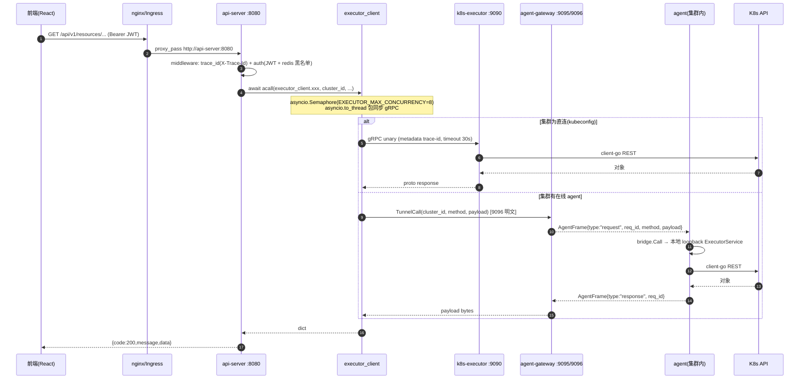
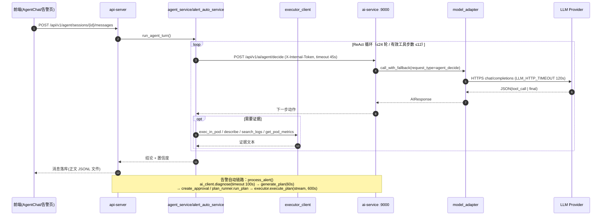

# 04 系统架构审计报告（AutoHealOps）

- 审计对象：`/Users/wolf/Documents/project/autohealops`
- 审计方式：**只读**源码审计（未修改任何业务代码/配置/YAML/依赖，未安装依赖，未连生产，未做 git 写操作）
- 审计范围：启动编排（start.sh / compose / k8s）、api-server 入口与后台循环、服务间调用（gRPC/HTTP）、Agent 隧道、数据面（MySQL/Redis/ES/Prometheus）、前后端接口
- 结论口径：所有结论带 `文件:行`；无法从源码确认的写「暂时无法确认」

---

## 1. 结论摘要

1. **系统是 5 个自有进程 + 3 个外部中间件的单体拆分架构**：`frontend(nginx)` → `api-server(FastAPI)` → {`k8s-executor(Go, gRPC)`、`ai-service(FastAPI)`、`agent-gateway(Python gRPC)`}，中间件为外部 MySQL / Redis / ES / Prometheus（`docker-compose.yml:1`、`k8s/deployments.yaml`）。
2. **存在两套运行时形态且拓扑不同**：本地/Compose 是「api-server 一个进程同时持有 8080+9095 隧道网关」（`start.sh:97-116`，`AGENT_GATEWAY_MODE` 默认 `inproc`，`api-server/app/core/config.py:100`）；K8s 是「网关拆成独立 `agent-gateway`（9095/9096）+ api-server 双副本」（`k8s/deployments.yaml:17,83-106`、`k8s/configmap.yaml:84`）。
3. **Agent 通道不是 WebSocket，是 gRPC HTTP/2 双向流 + mTLS**：`service AgentService { rpc Tunnel(stream AgentFrame) returns (stream AgentFrame); }`（`api-server/app/proto/agent.proto:10-12`），服务端实现见 `api-server/app/agent_gateway.py:252-350`，客户端见 `k8s-executor/cmd/agent/main.go:242-262`。
4. **api-server 启动时会拉起约 26 个后台协程**（审批超时、告警自动处理、日志告警扫描、恢复收敛、Pod 重启诊断、主动巡检、指标降采样、仪表盘预热等），全部在 `lifespan.startup_tasks()` 内创建（`api-server/app/main.py:544-570` + `startup_tasks` 全段）。
5. **k8s-executor 是第二个数据库写者**：它直连 MySQL（GORM）并把告警 `db.Create(&alert)` 写进 `alerts` 表（`k8s-executor/cmd/executor/main.go:45-47`、`k8s-executor/internal/watcher/sink.go:196-215`），同时再 HTTP 回调 api-server 触发处理（`k8s-executor/internal/watcher/notify.go:30-45`）。Schema 只由 api-server 的 alembic 管理（`api-server/alembic/versions`，124 个版本）。
6. **agent 接入的集群，任务实际在集群内执行**：平台把「方法名 + 原始 protobuf 字节」经隧道下发，agent 在进程内起一个真实的 `ExecutorService` gRPC server 承接（loopback + raw codec），因此 30+ 个 RPC 全量可用（`k8s-executor/internal/agentbridge/bridge.go:1-20,104`）。
7. **同步链路全部有显式超时，但预算分层严格**：api-server→executor 默认 30s（`executor_client.py:544`），AI 决策 45s / 诊断 100s / 方案 60s（`config.py:44-50`），ai-service 侧对应 40s/60s（`k8s/configmap.yaml:110-116`），代理层 120s（`api/api_proxy`→`api/ai_proxy.py:40`）。
8. **单点集中在 3 处**：`k8s-executor`（单副本、Recreate、单写 watcher，`deployments.yaml:147-152`）、`agent-gateway`（单副本 + RWO CA PVC，`deployments.yaml:86-90`）、以及 api-server 的「进程内后台循环 + 进程内隧道表」（`inproc` 模式下的 `_agents` 全局字典，`agent_gateway.py:26`）。

---

## 2. 服务级架构图

实线 = 同步调用；虚线 = 异步/轮询/事件推送。

```mermaid
graph TB
  subgraph Browser["浏览器"]
    FE["React SPA<br/>axios baseURL=/api/v1<br/>WS 终端 / SSE 日志"]
  end

  subgraph Edge["入口层"]
    NG["frontend(nginx) :80<br/>/api/v1 → api-server:8080"]
    ING["Ingress<br/>/api/v1→api-server, /→frontend"]
  end

  subgraph Core["平台侧"]
    API["api-server :8080<br/>FastAPI, 66 个 router<br/>26 个后台协程"]
    GW["agent-gateway :9095(mTLS) / :9096(内部明文)<br/>单副本 Recreate"]
    EXE["k8s-executor :9090 gRPC / :9099 HTTP<br/>单副本 Recreate"]
    AI["ai-service :9000<br/>LLM 编排 + RAG"]
  end

  subgraph Managed["被管集群"]
    AG["agent :9100(pull 模式)<br/>Deployment 单副本<br/>ClusterRole */*"]
    K8S["K8s API Server"]
  end

  subgraph Data["数据面（外部）"]
    MY[("MySQL 3306")]
    RD[("Redis 6379")]
    ES[("Elasticsearch")]
    PM[("Prometheus")]
    LLM["LLM Provider<br/>openai/deepseek/claude"]
  end

  FE -->|HTTP JSON| NG --> API
  FE -.->|WebSocket 终端| API
  FE -.->|SSE 日志/大屏| API
  API -->|gRPC 9090| EXE
  API -->|gRPC 9096 TunnelCall/StreamCall| GW
  GW <-->|gRPC 双向流 mTLS 9095| AG
  API -->|HTTP + X-Internal-Token| AI
  AI -->|HTTPS| LLM
  EXE -->|client-go| K8S
  AG -->|client-go in-cluster| K8S
  API -->|SQLAlchemy async| MY
  API -->|aioredis| RD
  EXE -->|GORM 直连（写 alerts）| MY
  AI -->|SQLAlchemy async（读模型配置）| MY
  EXE -->|HTTP 回调 /alerts/{id}/auto-process| API
  AG -.->|event 帧：告警/指标/事件| GW -.-> API
  AI -->|HTTP 5s| PM
  AI -->|HTTP| ES
  API -->|gRPC QueryPrometheus / HTTP 9099 /prom/range| EXE
```

---

## 3. 请求时序图

### 3.1 资源类请求（前端 → api-server → executor → K8s API）



### 3.2 AI 诊断链路（前端 → api-server → ai-service → 模型）



---

## 4. 端口 / 进程 / 部署单元表

| 单元 | 镜像/入口 | 端口 | 协议 | 副本 | 发布策略 | 探针 | 资源 req/lim |
|---|---|---|---|---|---|---|---|
| frontend | `autohealops/frontend:latest`（node 构建 → nginx）`frontend/Dockerfile:1-14` | 80 | HTTP | 2 | RollingUpdate | `/`（httpGet） | 未设置（`deployments.yaml:250-278`） |
| api-server | `autohealops/api-server:latest`，`uvicorn app.main:app` | 8080 HTTP；`inproc` 模式下额外 9095 gRPC | HTTP/JSON + WS + SSE | 2（HPA 2-5） | RollingUpdate maxUnavailable=0 | `/health`(live) `/ready`(db+redis) | 100m/256Mi → 500m/1Gi |
| agent-gateway | 同 api-server 镜像，`python -m app.agent_gateway_main` | 9095（mTLS，对外）/ 9096（内部明文 gRPC） | gRPC | 1 | **Recreate** | tcpSocket 9096 | 100m/256Mi → 500m/1Gi |
| k8s-executor | `autohealops/k8s-executor:latest`（Go 二进制） | 9090 gRPC / 9099 HTTP（logs、/healthz、/prom/range、/files） | gRPC + HTTP | 1 | **Recreate** | tcpSocket 9090 | 100m/256Mi → 1CPU/1Gi |
| ai-service | `autohealops/ai-service:latest` | 9000 | HTTP | 2（HPA 2-4） | RollingUpdate | `/live` `/ready` | 200m/512Mi → 2CPU/4Gi |
| agent（被管集群） | `harbor.efreight.cn/ops/autohealops-agent:0.2.7`（ConfigMap） | 9100（仅 pull 模式） | gRPC | 1 | Deployment 默认策略 | 无 | 由 install.yaml 模板给（`api/api/clusters.py:470-505`） |
| MySQL | 外部 192.168.6.99（`docker-compose.yml:1` 注释） | 3306 | MySQL 协议 | — | — | — | — |
| Redis | 外部 | 6379 | RESP | — | — | — | — |
| ES / Prometheus | 外部（ES 配置存 `system_settings`，`ai-service/app/services/es_client.py:13-35`） | — | HTTP | — | — | — | — |

批处理单元：

| 名称 | 类型 | 时序 | 作用 | 依据 |
|---|---|---|---|---|
| `api-server-migrate` | Job | 发布前手动 apply | `alembic upgrade head` | `k8s/migrate-job.yaml:20-46` |
| `autohealops-db-backup` | CronJob | `0 2 * * *` | mysqldump 到 PVC | `k8s/backup-cronjob.yaml:31` |
| `retention-purge` | CronJob | `30 3 * * *` | 配额/慢 SQL 等保留期清理 | `k8s/retention-cronjob.yaml:31,58` |

---

## 5. 启动流程

### 5.1 `start.sh`（本地 nohup 形态）逐步说明

| 步 | 行号 | 动作 |
|---|---|---|
| 0 | `start.sh:1-19` | 头注释即架构约束：**api-server 同一进程必须同时持有 8080 与 9095**，否则 agent 实时 RPC 全部回退本机 executor |
| 1 | `start.sh:24-28` | `set -uo pipefail`，创建 `logs/` |
| 2 | `start.sh:31-66` | 工具函数：`port_listening`/`pids_listening`（lsof）、`http_code`、`wait_port_free`、`kill_pattern` |
| 3 | `start.sh:68-100` | `stop_api_server`：先按完整 cmdline `pkill`，SIGTERM 6s 不退则 `-9`（已知 gRPC 线程卡住），最后兜底杀掉占用 8080/9095 的任何 PID |
| 4 | `start.sh:84-117` | `start_api_server`：先校验 8080/9095 归属；**若被两个不同 PID 占用则拒绝启动**；启动 `uvicorn --port 8080 --timeout-graceful-shutdown 8`；最多等 15s 校验两端口同 PID |
| 5 | `start.sh:119-123` | `start_ai_service`：`uvicorn app.main:app --port 9000` |
| 6 | `start.sh:125-144` | `start_executor`：跑 `./k8s-executor/bin/executor`，**等 9090 与 9099 都 LISTEN** 才算就绪（注释说明：api-server 启动瞬间会探活 + 查 Prometheus，早启动会误判 down） |
| 7 | `start.sh:146-150` | `start_frontend`：`vite` 开发服务器 5173 |
| 8 | `start.sh:152-165` | `start_all` 顺序：**executor → api-server → ai-service → frontend**（注释：反序会在启动窗口刷 UNAVAILABLE 并让仪表盘 60s 显示 executor down） |
| 9 | `start.sh:167-189` | `stop_all`：api-server（按名强杀）→ ai-service → 5173 → executor |
| 10 | `start.sh:191-215` | `status`：逐端口探测 + 双端口归属校验 |

### 5.2 api-server `lifespan` 起了什么（`api-server/app/main.py:544-570`）

```
lifespan():
  startup_tasks()                     # 见下
  if AGENT_GATEWAY_MODE == "inproc":   # 551
      agent_gateway.start_server(0.0.0.0:9095)   # 554，mTLS
  yield
  close_http_clients()                 # 566
  if inproc: agent_gateway.stop_server()          # 564-569
```

`startup_tasks()`（`main.py:299-542`）按顺序做：

1. Oracle thick 模式抢占初始化（`301-306`）
2. `seed_default_users()`：admin/operator/viewer，密码随机或取 `ADMIN_INITIAL_PASSWORD`，仅新创建时打印一次（`39-74`）
3. 集群凭据到期补齐（`308-315`）
4. 默认告警策略种子（`316-317`）
5. `scheduler_service.load_all_tasks()` + `start()`（`318-319`）
6. SQL 定时任务、报表推送、集群/DB 定时巡检、存量定时诊断的 cron 装载（`321-341`）
7. 长连接客户端：钉钉 Stream / 飞书长连接（含全局飞书审批回调）（`343-352`）
8. **独立后台循环（每 30s，各自 `asyncio.wait_for` 超时隔离）**：审批超时、告警自动处理、修复超时转人工、日志告警扫描、告警恢复关单、DB 审核单执行、僵尸计划收尾（5s）（`356-379`）
9. 提示词模板体检（3600s）、慢 SQL 明细采集（30s）/清理（86400s）（`381-388`）
10. `_maintenance_loop()`：慢 SQL 全量采集（60s）、指标降采样（10min）、分区维护+清理（1h）、快照/巡检/日志/K8s 事件保留清理（每日）（`117-236`）
11. `_agent_cluster_health_loop()`：每 60s 经隧道对 agent 集群 `HealthCheck`，**连续 2 次失败才判 unreachable**（`241-296`）
12. `_pull_clusters_refresh_loop()`：每 30s 把 pull 模式集群的地址/令牌刷进 `executor_client` 进程内表（`299-338`）
13. 会话历史清理（6h）、未连接凭证清理（10min）、**仪表盘预热（10s）**（`395-406`）
14. 云原生 RBAC 存量接入（后台任务，等 3s）（`341-362`）
15. 资源阈值告警扫描（60s）、节点恢复 uncordon（300s）、恢复收敛（60s）、告警爆发汇总（60s）、DB 连接告警（60s）、Pod 重启诊断（60s）、异常 Pod 日志留存（180s）、主动诊断（默认 30min）、executor 掉线探测（60s）、AI 用量巡检（1h）、主机进程监控（60s）、会话定时采集（60s）（`417-505`）
16. 录制/录像清理（12h）、凭据到期提醒（1h）（`507-540`）

> 结论：api-server 是「API 网关 + 调度中心 + 后台任务宿主」三合一。**这些循环没有任何"是否主副本"的判断**，多副本时每个副本都会跑（见 ARCH-03）。

### 5.3 agent 启动流程（被管集群内，`k8s-executor/cmd/agent/main.go`）

| 步 | 行号 | 动作 |
|---|---|---|
| 1 | `104-190` | flag 解析；mTLS 证书（`-ca-file/-cert-file/-key-file`）；`grpc.WithKeepaliveParams(30s/10s, PermitWithoutStream)`（`195-199`） |
| 2 | `212-220` | `-mode=pull` → 不起隧道，`bridge.ServePull(:9100)`（push 模式才有 watcher/指标上报） |
| 3 | `222-240` | `grpc.NewClient(platform)` + 断线循环，**3s 重连** |
| 4 | `261` | 建流后第一帧 `type:"register"`（cluster_id / token / version / capabilities） |
| 5 | `264-300` | 起 5 个上报协程：Pod 指标(60s)、DB 指标(10s/慢SQL 60s)、配额快照(60s)、K8s 事件(60s)、主机指标(60s) |
| 6 | `305-330` | 收到 `config` 帧后才启 Pod/Node watcher；15s 兜底用默认策略启动（`334`） |
| 7 | `340-455` | 主循环 `stream.Recv()`：`register_ack` / `ping→pong` / `config` / `request` / `stream_open` |

---

## 6. 模块调用关系矩阵

| # | 调用方 | 被调方 | 协议 / 端点 | 超时 | 代码依据 |
|---|---|---|---|---|---|
| 1 | 前端 | api-server | HTTP JSON，`baseURL='/api/v1'`，`timeout 30000`；401 → 弹登录，`code!=200` 统一报错；428 交调用方走审批 | 30s（个别接口单独覆盖，如 jvm ai-analyze 300s） | `frontend/src/services/api.ts:10-11,31-68`；`api.ts:1164` |
| 2 | 前端(dev) | api-server | Vite proxy `/api/v1` → `http://127.0.0.1:8080`，`ws:true` | — | `frontend/vite.config.ts:13-21` |
| 3 | 前端(prod) | api-server | nginx `location /api/v1 → http://api-server:8080` | — | `frontend/nginx.conf:14-19` |
| 4 | 前端 | api-server | WebSocket 交互终端 `ws/clusters/{id}/namespaces/{ns}/pods/{pod}/exec?token=` | 无（长连） | `api/api/terminal.py:38-55` |
| 5 | 前端 | api-server | SSE：日志流 / 仪表盘 / 大屏 | 长连 | `api/api/workload_logs.py:298`、`stats.py:1488`、`screens.py:70` |
| 6 | api-server | k8s-executor | gRPC unary/stream，`K8S_EXECUTOR_GRPC_ADDR`（默认 localhost:9090），`insecure_channel`，metadata `trace-id` | 默认 `ExecutorClient.TIMEOUT=30`；per-call 60/90/120/360/600 | `clients/executor_client.py:47-53,544`；`581-1100` 各方法 |
| 7 | api-server | k8s-executor | HTTP 日志流 `EXECUTOR_LOGSTREAM_ADDR`：`/logs`(SSE 源)、`/healthz`、`/prom/range`、`/files` | 3s(health) / 60s(prom) | `api/api/logs.py:106`、`services/prometheus_service.py:232`、`services/executor_health_service.py:26-40` |
| 8 | api-server | agent-gateway | gRPC 明文 9096：`TunnelCall` / `TunnelStreamCall` / `IsConnected` / `IssueClientCert` | `t+5s`；IsConnected 5s | `clients/executor_client.py:94-120`；`agent_gateway_service.py:27-82` |
| 9 | agent-gateway | agent | gRPC 双向流 9095，mTLS（`require_client_auth=True`） | 服务端 keepalive 30s/10s | `agent_gateway.py:351-413`；`proto/agent.proto:10-12` |
| 10 | agent | 集群 K8s API | client-go（in-cluster 或 kubeconfig）；隧道请求 → 本地 loopback ExecutorService（raw codec） | 由请求上下文/调用方决定 | `agentbridge/bridge.go:104-160,260-340` |
| 11 | api-server | ai-service | HTTP POST，头 `X-Internal-Token=JWT_SECRET_KEY`，`trust_env=False` | 决策 45 / 诊断 100 / 方案 60 / 其他 120，连接 5s | `clients/ai_client.py:15-40`；`core/config.py:44-50` |
| 12 | 前端 | api-server(代理) | `/api/v1/ai/*` 通用代理，剥离用户 JWT、注入内部 token | 120s | `api/api/ai_proxy.py:19-47` |
| 13 | ai-service | LLM Provider | HTTPS，适配器 openai/deepseek/claude；模型配置来自 DB `ai_model_configs`（API Key 加密） | 单请求 120s，上层 40/60s | `ai-service/app/services/model_adapter.py:115-135,184-270`；`core/config.py:44` |
| 14 | ai-service | MySQL | SQLAlchemy async（读 `ai_model_configs`/`system_settings`/写 `ai_call_logs`），**不建表** | pool 20+40 | `ai-service/app/core/database.py:14-22` |
| 15 | ai-service | Prometheus / ES | HTTP GET，Prometheus 5s；ES 配置 60s 进程内缓存 | 5s | `services/prometheus_client.py:16-45`；`services/es_client.py:13-60` |
| 16 | k8s-executor | MySQL | GORM 直连（DSN 由 SQLAlchemy URL 转换），**写 alerts / 读 clusters、alert_policies** | 无显式超时 | `internal/config/config.go:63-110`；`internal/watcher/sink.go:196-215` |
| 17 | k8s-executor | api-server | HTTP POST `/api/v1/alerts/{id}/auto-process`、`/recovery-notify`，头 `X-Internal-Token`；异步 goroutine，失败只记日志 | 默认 http.Client | `internal/watcher/notify.go:30-80`；`api/api/alerts.py:532-556` |
| 18 | k8s-executor | 集群 K8s API | client-go 多集群 Manager（kubeconfig 解密 `ENCRYPTION_KEY`） | 由 client-go | `cmd/executor/main.go:135-141` |
| 19 | agent | 平台 | 隧道 `event` 帧：`AlertEvent`/`AlertResolve`/`PodMetrics`/`DbMetrics`/`CollectSnapshot`/`Events`/`HostMetrics` | 由上报协程节流 | `cmd/agent/main.go:309,615-810`；`services/agent_alert_service.py:239-262` |
| 20 | api-server | MySQL / Redis | SQLAlchemy async（pool 20+40，recycle 1800s）；aioredis（pool 50，keepalive，retry_on_timeout） | connect 3s / socket 5s | `core/database.py:19-26`；`core/redis_client.py:10-20` |

**Redis 键用途**（grep 实测）：分布式锁 `lock:alert:{id}`、`lock:alert_auto`、`lock:custom_task:{id}`、`lock:sql_task:{id}`、`lock:batch:{id}`、`lock:approval_timeout`、`lock:log_alert`、`lock:db_alert`、`lock:pod_restart`、`lock:proactive_scan`；缓存/去重 `cache:dashboard:gen`（仪表盘代次）、`alert:repairing:{id}`、`alert:ticket_cooldown:{id}`、`notify_limit:{kind}:{id}`、`token_blacklist:{token}`、`platform:executor_state`（`core/redis_client.py:88-150`；`middleware/auth.py:30`；`services/executor_health_service.py:22`）。

---

## 7. Agent 通信机制：真实结论（含证据）

**结论一：协议是 gRPC 双向流，不是 WebSocket。**

```proto
// api-server/app/proto/agent.proto:10-12
service AgentService {
  rpc Tunnel(stream AgentFrame) returns (stream AgentFrame);
}
```

- 服务端：`api-server/app/agent_gateway.py:252-350`（`_Servicer.Tunnel`，同步 gRPC server 跑在后台线程池 `max_workers=20`，`351-364`）
- 客户端：`k8s-executor/cmd/agent/main.go:242-262`（`agentpb.NewAgentServiceClient(conn).Tunnel(ctx)`）
- 传输安全：`grpc.ssl_server_credentials(..., require_client_auth=True)` → **mTLS**（`agent_gateway.py:398-406`）；agent 侧 `credentials.NewTLS`（`main.go:157-169`）

**结论二：注册 = 建流后第一帧，不是独立 RPC 或 HTTP 注册接口。**

| 环节 | 实现 | 证据 |
|---|---|---|
| agent 发起注册 | `AgentFrame{Type:"register", ClusterId, Token, Version, Capabilities}` | `cmd/agent/main.go:261` |
| 平台校验 | `sha256(token) == cluster.agent_token_hash`；通过则 `agent_status="connected"`、`agent_last_seen_at=now()`、版本/能力落库 | `agent_gateway.py:44-53` |
| 注册失败 | `context.abort(UNAUTHENTICATED, err)` 直接断流 | `agent_gateway.py:274-277` |
| 注册成功 | 回 `register_ack`，并把该连接放入进程内 `_agents[cluster_id]` | `agent_gateway.py:278-281` |
| 配置下发 | 注册后立即 `_push_config()`，发 `type:"config"`（告警策略 JSON） | `agent_gateway.py:225-241,284` |
| 集群自动接 RBAC | 若 `rbac_mode=="off"` → `asyncio.create_task(_post_connect_setup)` | `agent_gateway.py:55-58,70-78` |

**结论三：心跳不是应用层 ping/pong，而是 gRPC HTTP/2 keepalive。**

- agent 侧：`keepalive.ClientParameters{Time:30s, Timeout:10s, PermitWithoutStream:true}`（`main.go:195-199`）
- 网关侧：`grpc.keepalive_permit_without_calls=1, min_time_between_pings=10s, max_pings_without_data=0, keepalive_time 30s, timeout 10s`（`agent_gateway.py:366-376`），注释说明默认策略会把 agent 心跳判为 "too many pings" 导致反复掉线。
- **协议里定义了 `ping`/`pong` 帧，agent 也实现了应答**（`main.go:352-353`），但**平台侧代码没有任何发送 ping 的位置**（全仓 grep `"ping"` 在 api-server 下只命中 `api/mcp.py:76` 的 MCP 协议应答）→ 该分支当前是**未被使用的协议预留**。
- 因此 `agent_last_seen_at` **只在注册那一刻写入**（`agent_gateway.py:51`），不能当作「最近心跳时间」使用；平台判定在线靠 `is_connected()`（`agent_gateway.py:106-110`，即 `_agents` 里存活对象）。

**结论四：任务下发 = 平台侧 per-connection 出站队列；结果回传 = req_id 关联的 Event/Queue。**

- 下发：`call()` 生成 `req_id`，登记 `pending[req_id]`，把 `AgentFrame{type:"request"}` 塞进 `a.out` 队列，`threading.Event.wait(timeout)` 阻塞（`agent_gateway.py:135-157`）；出站循环 `while context.is_active(): a.out.get(timeout=1.0)` 逐帧 `yield`（`agent_gateway.py:306-315`）。
- 回传：agent `handleRequest` 生成 `AgentFrame{type:"response", req_id, payload}`（`main.go:456-458`）；平台 reader 线程按 `req_id` 取出 `pending` 槽、填 payload、`event.set()`（`agent_gateway.py:292-299`）。
- 流式：`stream_open` / `stream_msg` / `stream_end` / `stream_error` 四类帧；服务端流（`ExecutePlan`/`BatchExecute`）单向下发，双向流（`ExecPodStream` 终端）走 `bidi_call` + 上行 pump 线程（`agent_gateway.py:159-224`；agent 侧 `main.go:363-455`）。
- 特别注意：`stream.Send` 非并发安全，agent 用 `sendMu` 串行化（`main.go:250-258`）。

**结论五：还有第二条通道 `pull` 模式（平台直连 agent）。**

- 平台侧：`_PULL_TARGETS` 进程内表由后台 30s 刷新（`main.py:299-338`），调用走 `grpc.insecure_channel(url)` + `authorization: Bearer <token>` metadata（`executor_client.py:399-464`）。
- agent 侧：`-mode=pull` 时 `bridge.ServePull(:9100)`，unary/stream 拦截器校验 token（`bridge.go:164-247`），可选 TLS/mTLS（`main.go:212-220`）。
- **限制（源码明确）**：pull 模式不启用 watcher/指标/事件上报等推送能力（`main.go:207-210` 注释 + 代码只在 push 分支启动这些协程）。

**结论六：隧道方法不止 `executor.proto` 里的 RPC，还有 12 个「JSON 自定义方法」。**

`PromRange`、`DbHealth`、`DbObjectDDL`、`DbExport`、`DbImport`、`CreateDatabase`、`DropDatabase`、`ImportSqlRaw`、`Backup`、`DbSchemaByKey`、`QueryDatabaseByKey`、`QueryDatabase`（`cmd/agent/main.go:460-585`）。这些方法**不在 proto 服务定义内**，是靠 `method` 字符串 + JSON payload 分派的旁路协议——属于隐式契约，改名前必须同步两侧。

---

## 8. 功能状态清单（架构视角）

| 功能 | 状态 | 证据 |
|---|---|---|
| 前端→后端单一 API 出口（/api/v1） | 已实现（有代码依据） | `frontend/nginx.conf:14-19`；`k8s/ingress.yaml:9-25` |
| 多集群直连（kubeconfig）执行 | 已实现（有代码依据） | `executor_client.py:51-53`；`internal/k8sclient` Manager |
| Agent 反向隧道（push） | 已实现（有代码依据） | `agent_gateway.py:252-350`；`proto/agent.proto` |
| Agent pull 模式 | 部分实现 | 桩/调用齐全，但**推送类能力（watcher/指标/事件）在 pull 下不启用**（`main.go:207-220`） |
| 网关拆分（remote 模式） | 部分实现 | 服务与内部 RPC 齐全（`agent_gateway_main.py`、`agent_gateway_service.py`），但**双向流未实现**（`executor_client.py:146-150` 直接抛错）、**能力协商未实现**（`184-186`）、**多处仍直连 inproc 模块**（见 ARCH-02） |
| AI 诊断（单轮 / 多轮 ReAct） | 已实现（有代码依据） | `ai_client.py:107-119`；`agent_service.py:294-430` |
| AI 代理路由 | 已实现（有代码依据） | `api/api/ai_proxy.py:26-47` |
| 告警 watcher（executor 侧直连集群） | 已实现（有代码依据） | `cmd/executor/main.go:70-75`；`watcher/sink.go:196-215` |
| 告警 watcher（agent 侧，集群内） | 已实现（有代码依据） | `cmd/agent/main.go:305-330`；`services/agent_alert_service.py:239-262` |
| 实时日志跟随（SSE） | 已实现（有代码依据） | `logstream/server.go:44-52`；`api/api/workload_logs.py:298` |
| 交互终端（WebSocket → ExecPodStream） | 已实现（有代码依据） | `api/api/terminal.py:38-99`；`executor_client.py:349-375` |
| 数据库直连诊断（api-server 侧驱动） | 已实现（有代码依据） | `services/diagnostic_service.py:26-92` |
| 数据库操作经 agent 执行（DbExport/Import 等） | 部分实现 | 方法存在（`main.go:504-575`），是否全部有 UI 入口未逐一核对 |
| Prometheus 趋势查询 | 已实现（有代码依据） | `services/prometheus_service.py:220-244`（隧道 PromRange → 9099 /prom/range 回退） |
| 仪表盘缓存实时失效 | 已实现（有代码依据） | `core/redis_client.py:88-150`；`core/orm_hooks.py` |
| 前端自动登录续期/静默刷新 | 完全未实现 | 仅 401 弹「去登录」（`api.ts:15-28`），无 refresh token 逻辑 |

---

## 9. 单点 / 耦合 / 故障域分析

### 9.1 api-server 的「单副本约束」在代码里是什么

代码里**没有任何**「我是主副本 / 抢 leader」的判断，`startup_tasks()` 无条件执行。真正的单副本约束来自三处：

1. **进程内 agent 隧道表**：`_agents: dict[int, _AgentConn]` 是模块级全局变量（`agent_gateway.py:26`）。`inproc` 模式下 agent 连到哪个 Pod，只有那个 Pod 能下发任务；其他副本的 `is_connected()` 返回 False → 落到本机 executor → 报 `no configuration has been provided`（`executor_client.py:286-296` 专门为此改写错误文案）。
2. **进程内 pull 目标表**：`_PULL_TARGETS`（`executor_client.py:379-397`），每个副本各自 30s 刷新，尚未收敛时行为不一致。
3. **`start.sh` 的双端口归属校验**：脚本层强制 8080/9095 同 PID（`start.sh:88-116`），这是对同一个约束的运维兜底。

K8s 侧用「拆出 agent-gateway + api-server 双副本」绕开了第 1 条（`deployments.yaml:79-118`），但**没有解决第 4 条：后台循环重复执行**（见 ARCH-03）。

### 9.2 故障域

| 故障 | 影响面 | 依据 |
|---|---|---|
| k8s-executor 挂 | 所有**直连（kubeconfig）集群**的资源页、执行、日志、Prometheus 全部不可用；agent 集群仍可经隧道工作（`_TunnelAwareStub` 优先走隧道） | `executor_client.py:249-300` |
| agent-gateway 挂 / 重启 | **所有 agent 集群**隧道断开（单副本 Recreate + RWO PVC），agent 3s 后重连但需网关就绪；期间任务全失败 | `agent_gateway.py:415-439`；`main.go:232-238` |
| CA 卷丢失 | 全部已下发 agent 的客户端证书失效，必须逐集群重装（启动时打 ERROR） | `agent_gateway.py:390-397` |
| ai-service 挂 | 诊断/方案/RAG 全链路失败；告警自动处理降级为「转人工」类分支（取决于调用异常处理） | `ai_client.py:31-40` 抛 RuntimeError |
| Redis 挂 | `auth` 降级放行（黑名单校验失败仅告警，`middleware/auth.py:30-35`）；分布式锁失效 → 多副本重复执行；`/ready` 返回 503 → Pod 被摘流量 | `main.py:614-629` |
| MySQL 挂 | 全站 500（`/ready` 失败）；executor 也无法写告警 | `core/database.py`；`cmd/executor/main.go:46` |
| 网关 9096 明文被内网嗅探 | 可伪造 `TunnelCall` 直接向任意 agent 下发 `method`（含 DeleteResource/ExecPodStream） | `agent_gateway_service.py:87-95`（无鉴权） |

### 9.3 关键耦合

1. **共享数据库 = 共享 schema 契约**：api-server（alembic 定义）、ai-service（独立 `Base` + 手写模型，`ai-service/app/models/__init__.py`）、k8s-executor（GORM struct）三方各自建模。任何列改名都会静默炸在另外两侧（GORM/AI 侧无迁移校验）。
2. **内部鉴权 token 复用 `JWT_SECRET_KEY`**：`X-Internal-Token` 直接等于 JWT 签名密钥（`ai_proxy.py:23`、`ai_client.py:28`、`alerts.py:539`、`cmd/executor/internal/config/config.go:66`）。拿到它的组件可同时伪造用户 JWT 与内部调用。
3. **`_TunnelAwareStub` 的隐式分支**：30+ 个方法不改调用点，靠 `req.cluster_id` + 在线判断决定走隧道/直连/pull（`executor_client.py:249-300`）。好处是扩展零改动，代价是「一次调用实际走哪条路」只能运行时看日志。
4. **直连 `agent_gateway` 模块的旁路**：`prometheus_service.py:222`、`db_connections.py:434` 直接 `from app import agent_gateway`，绕过 `_gateway_call` 的 remote 分支 → remote 模式下这些能力静默退化为「走直连 executor」并失败（ARCH-02）。

---

## 10. 问题清单

```
问题编号：ARCH-01
问题名称：两套部署拓扑不一致，Compose 形态下 Agent 隧道不可用
问题等级：P1
所属模块：部署编排 / Agent 接入
问题描述：
  K8s 用独立 agent-gateway（ConfigMap AGENT_GATEWAY_MODE=remote），而 docker-compose 与
  本地 start.sh 走 inproc。docker-compose 的 api-server 只映射 8080:8080（未映射 9095），
  executor 只映射 9090（未映射 9099），被管集群的 agent 无法连到网关；同时 compose 未设置
  AGENT_GATEWAY_MODE，代码默认值为 inproc，导致「网关在 api-server 进程里但对外不可达」。
代码位置：
  docker-compose.yml:4-17（api-server ports 仅 8080；无 AGENT_GATEWAY_MODE）
  api-server/app/core/config.py:96-101（默认 inproc，注释记录过 ConfigMap 漏项导致 remote 失效）
  k8s/configmap.yaml:84（AGENT_GATEWAY_MODE: "remote"）
  start.sh:1-19,84-117（本地强制 8080/9095 同进程）
涉及函数或类：Settings.AGENT_GATEWAY_MODE、agent_gateway.start_server、agent_gateway_main.main
调用链：agent → 平台:9095（Compose 无映射）→ 连接被拒 → cluster.agent_status 永远 pending
根本原因：网关形态（进程内/独立）与暴露端口由两套编排各自维护，没有单一事实源
可能影响：Compose/本地环境完全无法接入 agent 集群；排障时易误判为「agent 镜像问题」
修改建议：
  1) compose 增加 AGENT_GATEWAY_MODE 与 9095 端口映射（或加一个 agent-gateway service）；
  2) 把 AGENT_GATEWAY_MODE 的默认值改为必填（无默认），启动时缺失直接 fail-fast；
  3) 在 /ready 里校验「模式与端口归属一致」。
验证方法：docker compose up 后从另一容器 nc -zv <host> 9095；或启动日志确认
  「Agent 反向隧道网关已启动（mTLS）」
是否需要立即处理：是
```

```
问题编号：ARCH-02
问题名称：remote 网关模式下存在绕过远端网关的直连调用（静默失效）
问题等级：P1
所属模块：api-server / 客户端层
问题描述：
  executor_client 提供了 _gateway_call/_gateway_is_connected 做 inproc/remote 分流，但
  prometheus_service 与 db_connections 直接 import app.agent_gateway 调用 is_connected/call。
  remote 模式下 api-server 进程内 _agents 恒为空 → 判定「不在线」→ 回退直连 executor →
  平台侧没有该集群 kubeconfig → 报错。此外能力协商（_agent_capabilities）与双向流
  （_gateway_bidi_call）在 remote 下直接返回 None / 抛异常。
代码位置：
  api-server/app/services/prometheus_service.py:220-232
  api-server/app/api/db_connections.py:434-437
  api-server/app/clients/executor_client.py:146-150,182-195
涉及函数或类：agent_gateway.is_connected / agent_gateway.call / _gateway_bidi_call /
  _agent_capabilities / check_agent_feature
调用链：
  query_metric_range() → agent_gateway.is_connected(cid)（本地字典，remote 恒 False）
  → 回退 EXECUTOR_LOGSTREAM_ADDR/prom/range → executor 无 kubeconfig → 报错
根本原因：拆分网关时只给 executor_client 加了模式抽象，旁路调用点未统一收口
可能影响：remote 模式下 agent 集群的指标趋势、DB 操作（QueryDatabaseByKey）不可用；
  终端在 remote 模式下直接不可用（明确抛 RuntimeError）
修改建议：
  1) 全仓禁止 `from app import agent_gateway`（除 executor_client 与网关自身），改走统一门面；
  2) 补 remote 模式的 IsConnected 用于所有在线判断；
  3) 明确记录「remote 不支持 ExecPodStream」并在 UI 置灰而非运行时报错。
验证方法：AGENT_GATEWAY_MODE=remote 起 api-server + agent-gateway，对 agent 集群调
  指标趋势接口与 DB 导出接口，确认无「no configuration has been provided」
是否需要立即处理：是
```

```
问题编号：ARCH-03
问题名称：api-server 多副本时后台循环在每个副本重复执行
问题等级：P1
所属模块：api-server 调度
问题描述：
  startup_tasks() 无条件创建 26 个后台协程（告警自动处理、日志告警扫描、恢复收敛、
  Pod 重启诊断、主动巡检、指标降采样/分区维护、仪表盘预热、凭据提醒等）。
  K8s 中 api-server replicas=2 且 HPA 可到 5，因此同一轮任务最多 5 份并发。
  部分循环有 Redis 锁（lock:alert_auto / lock:log_alert / lock:pod_restart / lock:db_alert
  / lock:proactive_scan / lock:approval_timeout），但 _maintenance_loop（慢 SQL 采集、
  指标 rollup、分区 DROP、各类保留期清理）、_agent_cluster_health_loop、仪表盘预热、
  凭据到期提醒、executor 健康探测等**没有抢锁**。
代码位置：
  api-server/app/main.py:544-570（lifespan 无条件 startup_tasks）
  api-server/app/main.py:117-236（_maintenance_loop 无锁）
  api-server/app/main.py:241-296（_agent_cluster_health_loop 无锁）
  api-server/app/services/alert_auto_service.py:3839（有锁的对照组）
涉及函数或类：startup_tasks、_interval_worker、_maintenance_loop、
  _agent_cluster_health_loop、_pull_clusters_refresh_loop
调用链：每个 Pod 启动 → startup_tasks → asyncio.create_task(...) × 26
根本原因：后台任务宿主与 API 进程同体，缺少 leader election / 单例调度器
可能影响：重复写库（重复通知/重复工单/重复 AI 调用计费）；分区 DROP 并发可能报错；
  慢 SQL 采集翻倍打外部库
修改建议：
  1) 短期：所有后台任务统一包一层 Redis 锁（key 带任务名 + 周期桶），拿不到就跳过；
  2) 中期：拆出独立 scheduler 进程（replicas=1 + Recreate），api-server 只保留请求路径；
  3) 加指标：每个任务记录「本副本是否获得执行权」，便于核对。
验证方法：kubectl scale 到 3 副本，观察同一条告警是否产生多条通知/AI 调用日志
是否需要立即处理：是
```

```
问题编号：ARCH-04
问题名称：alerts 表存在两个写者（Python ORM + Go GORM），无单一写者约束
问题等级：P1
所属模块：数据面 / 告警链路
问题描述：
  k8s-executor 直连 MySQL，watcher 检测到故障后直接 db.Create(&alert) 写 alerts，
  随后 HTTP 回调 api-server 触发处理；同时 api-server 自己的告警接口、
  自动处理、恢复收敛循环也在写同一张表。schema 只由 api-server 的 alembic 管理，
  Go 侧是手写 struct，无迁移与列校验。
代码位置：
  k8s-executor/cmd/executor/main.go:45-47（database.Init(DatabaseURL)）
  k8s-executor/internal/watcher/sink.go:196-215（db.Create(&alert)）
  k8s-executor/internal/watcher/sink.go:290-320（批量 update 状态）
  api-server/app/api/alerts.py:532-556（回调入口）
涉及函数或类：watcher.Sink、database.Alert、auto_process_alert
调用链：
  watcher 检测 → sink 写入 alerts → triggerAlertProcess POST /api/v1/alerts/{id}/auto-process
  → api-server 异步 process_alert → 读同一行 → 可能再改状态
根本原因：executor 为了低延迟与「平台库不可达也能落库」选择了直连 DB，形成双写
可能影响：
  - 列改名/加非空列时 Go 侧静默失败（GORM 只报 SQL 错误，无编译期保护）；
  - 写库与回调之间的窗口内，api-server 可能读到半初始化的行；
  - 回调失败只记日志，靠 30s 轮询兜底（notify.go:41-45），存在延迟与漏处理风险
修改建议：
  1) 把「写告警」收敛为单一写者：要么 executor 只发事件、由 api-server 写库，
     要么 executor 写完只更新 outbox 表；
  2) 若保留双写，为 Go 侧加 schema 契约测试（对 alembic head 做列比对）；
  3) 回调改为带重试的可靠投递（或 outbox + 消费者）。
验证方法：在 alembic 新增一列后跑 executor 集成测试，确认 Go 侧 INSERT 不报错
是否需要立即处理：是
```

```
问题编号：ARCH-05
问题名称：k8s-executor 单副本是硬约束，构成直连集群的全局单点
问题等级：P2
所属模块：k8s-executor 部署
问题描述：
  Deployment replicas=1、strategy=Recreate，注释写明「有状态 watcher（单写者）」。
  这意味着滚动升级或节点故障时，所有 kubeconfig 直连集群的资源查询/执行/日志全部中断，
  且没有任何降级路径（agent 集群除外）。
代码位置：
  k8s/deployments.yaml:144-152（replicas 1 + Recreate + 注释）
  k8s/pdb.yaml（PDB 只覆盖 api-server 与 ai-service，未覆盖 executor）
  k8s/hpa.yaml（无 executor 的 HPA）
涉及函数或类：watcher.WatchManager、quota.Collector、metrics.Collector
调用链：api-server → gRPC 9090 → 单 Pod → 失败即全量 UNAVAILABLE
根本原因：watcher 采用「单写者直接写库」模型，扩副本会双写告警
可能影响：发布窗口内监控/自愈能力完全失效；executor 崩溃后无法自动多副本接管
修改建议：
  1) 把 watcher 与「请求执行」拆成两个 Deployment（执行层可多副本无状态）；
  2) 或给 watcher 加基于 Redis 的 leader election，执行层 replicas=2+；
  3) 至少补 PDB minAvailable=1 + 更快的重启探针。
验证方法：kubectl delete pod k8s-executor 后，测量资源页不可用时长
是否需要立即处理：否（但需列入架构演进）
```

```
问题编号：ARCH-06
问题名称：agent-gateway 单副本 + RWO 卷，重启即全体隧道中断
问题等级：P2
所属模块：Agent 网关
问题描述：
  agent-gateway replicas=1、Recreate，CA 目录挂 RWO PVC（autohealops-agent-ca）。
  Pod 重建期间所有 agent 隧道断开；agent 3s 重连但网关未就绪会持续失败；
  若 PVC 被误删/换节点挂载失败，CA 重新生成 → 所有已下发客户端证书失效。
代码位置：
  k8s/deployments.yaml:83-118（replicas 1 + Recreate + volumeMount /var/lib/autohealops/agent-ca）
  k8s/pvc-agent-ca.yaml:1-20（RWO + 说明）
  api-server/app/agent_gateway.py:390-397（CA 新建打 ERROR）
涉及函数或类：agent_pki.ensure_server_cert、agent_gateway.start_server
调用链：Pod 重建 → 端口不可达 → agent 重连失败（3s 重试）→ 任务全失败
根本原因：CA 私钥只在网关侧 + 连接表在进程内，无法水平扩展
可能影响：网关发布/漂移期间 agent 集群完全不可用；CA 丢失需逐集群重装 agent
修改建议：
  1) 用 RWX 卷或把 CA 放 Secret/KMS，支持多副本；
  2) 连接表外置（Redis 记录 cluster→gateway 实例），配合 gRPC 长连接粘性；
  3) 发布用 maxSurge 双活（需先解决 1、2）。
验证方法：滚动重启 agent-gateway，测量 agent 集群恢复时间
是否需要立即处理：否
```

```
问题编号：ARCH-07
问题名称：executor 日志流端口 9099 无任何鉴权
问题等级：P2
所属模块：k8s-executor / 数据暴露
问题描述：
  9099 上的 HTTP 服务提供 /logs（Pod 日志流）、/files、/prom/range、/watch，
  源码中没有任何 Authorization/token 校验。K8s 里靠 NetworkPolicy（仅允许
  app=api-server 入站）兜底，但本地 start.sh 直接监听 0.0.0.0:9099，同网段任何人
  只要知道 cluster_id 就能读任意 Pod 日志。
代码位置：
  k8s-executor/internal/logstream/server.go:44-52（路由注册，无中间件）
  k8s-executor/internal/logstream/server.go（全文件无 token 校验；grep Authorization 无命中）
  api-server/app/core/config.py:39（默认 http://localhost:9099）
  k8s/networkpolicy.yaml:1-16（唯一防护）
涉及函数或类：logstream.Server.handleLogs / handleFile / handlePromRange
调用链：任意 HTTP 客户端 → GET :9099/logs?cluster_id=&namespace=&pod= → 日志内容
根本原因：内部端口按「集群内可信网络」设计，未考虑本地/多租户场景
可能影响：日志泄露（可能含凭据/业务数据）；无审计
修改建议：
  1) 给 9099 加 X-Internal-Token 校验（与 api-server 对齐）；
  2) 默认监听 127.0.0.1（本地场景），集群内再用 0.0.0.0；
  3) NetworkPolicy 增加端口级限制。
验证方法：curl :9099/logs 不带任何头，若返回数据即为未鉴权
是否需要立即处理：是（本地/同网段场景）
```

```
问题编号：ARCH-08
问题名称：全局 gRPC 并发信号量把「后台循环」和「用户请求」放在同一配额里
问题等级：P2
所属模块：api-server 客户端层
问题描述：
  acall() 用模块级 asyncio.Semaphore(EXECUTOR_MAX_CONCURRENCY=8) 限制所有对 executor
  的同步调用（走 asyncio.to_thread）。后台循环（慢 SQL 采集、健康检查、恢复收敛）
  与用户请求共享这 8 个槽位；单次调用最长 600s（execute_plan），一旦被长任务占满，
  用户请求进入排队，前端 30s 超时先失败。
代码位置：
  api-server/app/clients/executor_client.py:23（Semaphore）
  api-server/app/clients/executor_client.py:26-32（acall 抢信号量）
  api-server/app/clients/executor_client.py:624-646（execute_plan timeout=600）
  k8s/configmap.yaml:23（EXECUTOR_MAX_CONCURRENCY: "8"）
涉及函数或类：acall、ExecutorClient.execute_plan
调用链：后台循环 N 个协程 → acall → 抢 8 个槽 → 长调用占满 → 用户请求排队
根本原因：单一全局信号量，无按调用方/优先级的隔离
可能影响：高峰期后台任务拖慢交互；故障时放大为「页面全卡」（前端 30s 超时）
修改建议：
  1) 拆两个信号量：交互（高优先级，如 8）与后台（低，如 4）；
  2) execute_plan/run_script 这类长任务不占交互信号量；
  3) 记录信号量等待时长指标。
验证方法：压测同时触发 10 个 execute_plan，测普通资源接口 P99
是否需要立即处理：否
```

```
问题编号：ARCH-09
问题名称：内部服务鉴权直接复用 JWT 签名密钥作为共享 token
问题等级：P2
所属模块：安全 / 服务间通信
问题描述：
  api-server→ai-service、executor→api-server 回调、ai_proxy 转发统一使用
  X-Internal-Token = JWT_SECRET_KEY。该密钥同时是用户 JWT 的签名密钥，
  任一持有者既能伪造任意用户身份，也能调用内部接口（含 /alerts/{id}/auto-process
  触发自动修复）。ai-service 的 CORS 还配了 allow_origins=["*"]。
代码位置：
  api-server/app/clients/ai_client.py:28
  api-server/app/api/ai_proxy.py:23
  api-server/app/api/alerts.py:539,553
  k8s-executor/internal/config/config.go:66（InternalToken = JWT_SECRET_KEY）
  ai-service/app/main.py:46-48（校验），59-63（CORS *）
涉及函数或类：internal_auth_middleware、auto_process_alert、_internal_headers
调用链：持有密钥者 → POST /api/v1/alerts/1/auto-process + X-Internal-Token → 自动诊断修复
根本原因：为了少配一个密钥而复用，耦合了「用户身份」与「服务身份」两个信任域
可能影响：密钥泄露时影响面从「会话伪造」扩大到「内部服务全量调用」
修改建议：
  1) 引入独立 INTERNAL_API_TOKEN（可轮换、按服务分权）；
  2) ai-service CORS 收敛为显式白名单或直接移除（它不该被浏览器直连）；
  3) 内部接口加来源校验（NetworkPolicy + mTLS 可选）。
验证方法：用错误 token 调 ai-service 应 401；用 JWT_SECRET_KEY 调应 401（改后）
是否需要立即处理：是
```

```
问题编号：ARCH-10
问题名称：pull 模式与 push 模式能力不对等，且差异只写在注释里
问题等级：P2
所属模块：Agent 接入
问题描述：
  pull 模式（平台直连 agent:9100）不启动 watcher、Pod/DB/主机指标上报、K8s 事件、
  配额快照——这些协程只在 push 分支启动。平台侧 UI 仍展示相同的集群能力，
  没有按 agent_mode 做能力提示；后台「agent 集群健康检查」也只筛选
  agent_status=='connected'（pull 集群不经过注册，状态由健康检查写）。
代码位置：
  k8s-executor/cmd/agent/main.go:207-220（pull 分支提前 return）
  k8s-executor/cmd/agent/main.go:264-300（仅 push 启动上报协程）
  api-server/app/main.py:258-262（健康检查只查 source=agent & agent_status=connected）
  api-server/app/api/clusters.py:345-392（pull 安装清单）
涉及函数或类：runTunnel、ServePull、_agent_cluster_health_loop
调用链：pull 集群 → 平台 30s 刷新 _PULL_TARGETS → 直连调用可用；事件/指标链路缺失
根本原因：两种接入模式共用一套数据模型，未在契约层声明能力差异
可能影响：pull 集群「没有告警、没有指标趋势、没有事件历史」，用户会误判为采集中断
修改建议：
  1) clusters 表增加 capabilities 字段（push/pull 各自声明）；
  2) UI 按能力隐藏/置灰指标、事件、告警页签；
  3) 或在 pull 模式也实现本地 watcher + 平台轮询拉取事件。
验证方法：建一个 pull 集群，观察 1 小时内 pod_metrics / k8s_events 是否有新增行
是否需要立即处理：否
```

```
问题编号：ARCH-11
问题名称：隧道自定义 JSON 方法不在 proto 契约内
问题等级：P2
所属模块：Agent 协议
问题描述：
  PromRange、DbExport、DbImport、CreateDatabase、DropDatabase、ImportSqlRaw、Backup、
  DbSchemaByKey、QueryDatabaseByKey、QueryDatabase、DbHealth、DbObjectDDL 这 12 个方法
  用 `method` 字符串 + JSON payload 走同一条 Tunnel，但不在 executor.proto 的
  ExecutorService 定义里。平台侧调用点（如 db_connections.py:434-437）以裸字符串引用，
  改名字符串两侧不同步就会在运行时表现为「unknown method」。
  另外这些方法携带的是破坏性操作（DropDatabase/ImportSqlRaw），却没有能力协商标记
  （_FEATURE_REQUIRED 只覆盖 hpa / log_time_range）。
代码位置：
  k8s-executor/cmd/agent/main.go:460-585（method 字符串分派）
  api-server/app/api/db_connections.py:434-437（调用方）
  api-server/app/clients/executor_client.py:169-180（能力表只含 hpa/log_time_range）
涉及函数或类：handleRequest、agentdb.*、_FEATURE_REQUIRED
调用链：平台 _gateway_call(cid, "DropDatabase", json) → agent 字符串匹配 → agentdb 执行
根本原因：proto 变更成本高（本机缺 protoc 插件，见 logstream/server.go 注释），走了 JSON 旁路
可能影响：老 agent 收到新方法名会返回 unknown method，但错误文案不会提示升级；
  破坏性方法没有能力门禁
修改建议：
  1) 把这些方法登记到 proto（或至少集中到一个常量模块，双侧引用）；
  2) 加入 _FEATURE_REQUIRED / _METHOD_TO_FEATURE，缺失时给「请升级 agent」文案；
  3) 破坏性方法增加平台侧二次确认与审计。
验证方法：对老版本 agent 调 DbExport，确认返回友好升级提示而非原始 gRPC 错误
是否需要立即处理：否
```

```
问题编号：ARCH-12
问题名称：schema 由三方各自建模，无契约校验
问题等级：P2
所属模块：数据面
问题描述：
  api-server 用 SQLAlchemy 模型 + 124 个 alembic 版本管理表结构；ai-service 有自己
  独立的 Base 与模型副本（ai_model_configs、system_settings、ai_call_logs 等）；
  k8s-executor 用 GORM struct（database.Alert 等）。三份定义没有自动比对，
  列改名/类型变更不会有编译期或启动期报错。
代码位置：
  api-server/alembic/versions（124 个）
  ai-service/app/core/database.py:12-16（独立 Base，注释「不建表」）
  ai-service/app/models/__init__.py:21-70（AIModelConfig/PromptTemplate 等副本）
  k8s-executor/internal/database（GORM 模型）
涉及函数或类：Base、AIModelConfig、database.Alert
调用链：alembic upgrade → 三侧运行 → 只有真正读写该列时才暴露不一致
根本原因：多语言单体拆分，未引入共享 schema 契约（如 protobuf/OpenAPI 生成或契约测试）
可能影响：发布后出现「某功能偶发 500 / 某字段永远为空」，排查成本高
修改建议：
  1) CI 加契约测试：连接一个由 alembic 建的空库，用 Go/AI 侧模型做 SELECT 1 探测；
  2) 或生成共享 schema 描述文件（JSON Schema）供三侧校验；
  3) 关键表变更走「先加列后删列」两阶段。
验证方法：在 CI 中对 alembic head 跑三侧的最小读写用例
是否需要立即处理：否
```

```
问题编号：ARCH-13
问题名称：agent 的 ClusterRole 权限过宽（*/*+impersonate），无命名空间边界
问题等级：P2
所属模块：Agent 安装清单 / 权限
问题描述：
  install.yaml 模板给 agent 的 ClusterRole 是 apiGroups:["*"] resources:["*"]
  verbs:get/list/watch/create/update/patch/delete，外加 users/groups/serviceaccounts
  的 impersonate。agent 一旦被攻破（或平台隧道被伪造），等于拿到被管集群的
  cluster-admin。agent 又以 Deployment 常驻，无 NetworkPolicy、无资源限制模板。
代码位置：
  api-server/app/api/clusters.py:441-467（ClusterRole/ClusterRoleBinding）
  api-server/app/api/clusters.py:470-505（Deployment 模板）
涉及函数或类：agent_install_yaml
调用链：平台 → agent 隧道 method=DeleteResource → agent 用 SA 权限删除任意资源
根本原因：为了支持全部 30+ RPC 与云原生 RBAC impersonation，直接给了超集权限
可能影响：单点失陷即集群失守；审计上无法区分「平台操作」与「agent 自身操作」
修改建议：
  1) 按实际使用的方法收敛 verbs/resources（去掉 delete 之外不需要的写权限，
     或对 delete 强制走审批 + 审计）；
  2) impersonate 单独拆 SA，默认不启用；
  3) 模板补 resources limits/requests 与 NetworkPolicy（仅允许出站到平台 9095）。
验证方法：kubectl auth can-i --list --as=system:serviceaccount:autohealops:autohealops-agent
是否需要立即处理：否（需产品确认最小权限集）
```

```
问题编号：ARCH-14
问题名称：协议里的 ping/pong 心跳帧是死代码，在线判定依赖 TCP keepalive
问题等级：P3
所属模块：Agent 协议
问题描述：
  agent.proto 注释列出 ping/pong，agent 侧实现了「收到 ping 回 pong」
  （main.go:352-353），但平台侧没有任何发送 ping 的代码（全仓 grep 无命中）。
  实际存活判定靠：gRPC keepalive（30s/10s）+ Tunnel 出站循环 context.is_active()。
  agent_last_seen_at 只在注册时写一次，若被前端当「最后在线时间」展示会永远显示注册时刻。
代码位置：
  api-server/app/proto/agent.proto:20（type 注释含 ping/pong）
  k8s-executor/cmd/agent/main.go:352-353（pong 应答）
  api-server/app/agent_gateway.py:51（last_seen 仅注册写）
  api-server/app/api/clusters.py:771,803（字段对外暴露）
涉及函数或类：_Servicer.Tunnel、runTunnel
调用链：无（平台不发 ping）
根本原因：功能预留未落地，注释与实现不同步
可能影响：运维误读「最后在线时间」；排查掉线时缺少应用层证据
修改建议：
  1) 要么实现平台侧定时 ping（30s）+ pong 超时判离线，并更新 last_seen；
  2) 要么删除 ping/pong 分支与注释，明确「keepalive 即心跳」；
  3) 前端文案改为「最后注册时间」。
验证方法：断网 60s 观察 cluster.agent_status 与实际连接状态是否一致
是否需要立即处理：否
```

```
问题编号：ARCH-15
问题名称：迁移执行方式在三种运行形态下不一致
问题等级：P3
所属模块：发布流程
问题描述：
  api-server/Dockerfile 的 CMD 默认 `alembic upgrade head && uvicorn`；
  K8s Deployment 用 RUN_MIGRATIONS=false 交给独立 Job；本地 start.sh 完全不跑迁移
  （依赖人工）。三种形态对「谁负责迁移」的约定不同，容易出现「镜像能跑但表是旧的」。
代码位置：
  api-server/Dockerfile:15-16（CMD 含 alembic）
  k8s/deployments.yaml:39-52（RUN_MIGRATIONS=false + 条件命令）
  k8s/migrate-job.yaml:1-20（注释：Job 名固定，每次发布前必须 delete）
  start.sh:84-117（无迁移步骤）
涉及函数或类：—（部署脚本）
调用链：发布 → 忘记 delete migrate job → apply 不重跑 → 新代码跑旧 schema
根本原因：迁移职责没有单一入口
可能影响：发布后出现列缺失类错误；本地环境长期落后于代码
修改建议：
  1) 统一为「迁移只由 Job/独立步骤执行」，镜像 CMD 去掉 alembic；
  2) migrate Job 名带版本号（或使用 helm hook）避免忘记 delete；
  3) start.sh 增加可选 `--migrate`。
验证方法：全新库执行发布流程，确认 schema 版本 = 代码期望版本
是否需要立即处理：否
```

```
问题编号：ARCH-16
问题名称：前端全局 30s 超时与后端长任务（诊断/执行计划）不匹配
问题等级：P3
所属模块：前后端契约
问题描述：
  axios 全局 timeout=30000（api.ts:11），但后端存在 45/60/100s 的 AI 调用与
  600s 的执行计划流。部分接口在调用点单独覆盖（如 jvm ai-analyze 300000），
  属于「按接口记忆」的散落配置；新增长任务接口若忘记覆盖会稳定超时。
代码位置：
  frontend/src/services/api.ts:10-11（全局 30s）
  frontend/src/services/api.ts:1164,1169（个别 300s）
  api-server/app/core/config.py:44-50（后端 45/60/100s）
涉及函数或类：axios 实例、http 门面
调用链：前端请求 → 30s 断开 → 后端仍在跑并写库（用户重试 → 重复执行风险）
根本原因：超时按接口零散覆盖，缺少统一的长任务通道（异步任务 + 轮询）
可能影响：重复触发诊断/执行；用户看到「网络错误」但实际已生效
修改建议：
  1) 长任务统一改为「提交 → 返回 task_id → 轮询/SSE」（已有 executions 轮询模式可复用）；
  2) 或 api.ts 暴露 withLongTimeout 包装器，禁止裸调用长接口；
  3) 后端对重复提交做幂等（trace_id/请求指纹）。
验证方法：弱网/慢模型下点「深度诊断」，观察是否出现重复 AI 调用记录
是否需要立即处理：否
```

---

## 11. 无法确认事项

| 事项 | 卡点 |
|---|---|
| 生产实际生效的 `AGENT_GATEWAY_MODE` | 只读到 ConfigMap 模板（`remote`）与 `.env` 中无该键；集群里 `k8s/generated/` 为 gitignore 生成物，未读取实际 Secret/ConfigMap 值 |
| MySQL / Redis 真实地址与规格 | `.env` 含凭据，审计按只读原则未读取具体值；仅从 `docker-compose.yml:1` 注释得知为外部 192.168.6.99 |
| agent 镜像实际版本与集群内运行态 | ConfigMap 写 `0.2.7`，代码默认 `0.2.18`（`core/config.py:76`），install.yaml 以请求参数为准 → 无法确认各集群实际版本 |
| 是否有外部对 9095/9099/9096 的四层暴露（SamWaf/nginx stream） | 仓库内 `services.yaml:38-56` 只给注释三选一，未包含实际 NodePort/LB 配置 |
| 26 个后台循环在生产的真实触发频率与耗时 | 需要运行日志/指标；本次只读代码，未连环境 |
| `retention_purge.py` 与 backup 脚本的实际内容完整性 | CronJob 以 ConfigMap 挂载脚本，脚本内容在 `k8s/retention-cronjob.yaml` 内嵌片段，未逐行核对全部 SQL |
| Redis 锁在 HPA 到 5 副本时的实际争抢表现 | 需压测/线上观测，代码只能证明「哪些任务加锁、哪些没加」 |
| 前端是否有未提交的本地改动影响 baseURL | 审计基于工作区文件，未做 `git status/diff`（避免 git 写操作；只读 diff 未执行） |

---

## 12. 审计方法与覆盖范围

**已精读（全文）**
- `start.sh`（全部 240 行）
- `docker-compose.yml`
- `k8s/deployments.yaml`、`services.yaml`、`configmap.yaml`、`ingress.yaml`、`hpa.yaml`、`pdb.yaml`、`networkpolicy.yaml`、`migrate-job.yaml`、`pvc-agent-ca.yaml`；`backup-cronjob.yaml` / `retention-cronjob.yaml`（结构与调度）
- `api-server/Dockerfile`、`ai-service/Dockerfile`、`k8s-executor/Dockerfile`、`frontend/Dockerfile`、`frontend/nginx.conf`、`frontend/vite.config.ts`
- `api-server/app/main.py`（737 行全文）
- `api-server/app/core/config.py`、`database.py`、`redis_client.py`
- `api-server/app/agent_gateway.py`（440 行全文）、`agent_gateway_main.py`、`agent_gateway_service.py`
- `api-server/app/proto/agent.proto`、`agent_gateway_internal.proto`（服务与方法）、`executor.proto`（服务与方法列表）
- `api-server/app/clients/ai_client.py`（全文）、`executor_client.py`（1-550 行逐行 + 余下方法签名/超时扫描）
- `api-server/app/api/ai_proxy.py`、`api/clusters.py:212-505`（agent 接入与 install.yaml）
- `api-server/app/services/diagnostic_service.py:1-160`、`agent_service.py`（结构 + 循环常量）、`agent_pki.py:1-90`、`prometheus_service.py:220-245`、`executor_health_service.py:20-60`、`agent_alert_service.py`（事件分派）
- `k8s-executor/cmd/agent/main.go`（关键段：180-585、615-810）、`internal/agentbridge/bridge.go`（1-80 + 函数清单）、`internal/watcher/notify.go`、`internal/config/config.go`、`internal/logstream/server.go:1-60`
- `k8s-executor/cmd/executor/main.go`（33-140）
- `ai-service/app/main.py`（108 行全文）、`ai-service/app/core/config.py`、`ai-service/app/core/database.py`、`ai-service/app/models/__init__.py`（模型清单）、`services/es_client.py`、`services/prometheus_client.py`、`services/model_adapter.py`（结构）
- `frontend/src/services/api.ts:1-120`

**扫描式阅读（grep + 定点读）**
- 全部 `api-server/app/api/*.py` 的路由与鉴权依赖（66 个 router 的注册顺序）
- Redis 键：`api-server/app/**` 全量 grep `cache:`/`alert:`/`lock:`/`token_blacklist`/`platform:` 等
- `from app import agent_gateway` 的所有旁路调用点
- 前端 WebSocket / EventSource / setInterval 使用点
- `X-Internal-Token` 的全部读写点

**未读（并说明原因）**
- 124 个 alembic 版本文件逐个内容（只统计数量与命名，schema 细节属于 03 数据模型报告范围）
- `api-server/app/services/*` 业务细节（告警决策、修复计划生成属 05 业务链路范围）
- `ai-service/app/services/*` 的 prompt 与 RAG 实现细节（属 06 AI 链路范围）
- `k8s-executor/internal/{k8sclient,quota,metrics,eventstore,script}/` 内部实现（只在 main.go 确认了调度关系）
- 前端页面级组件（只审计了请求层）

**未执行的操作（合规说明）**：未修改任何文件（仅新建本报告）、未安装依赖、未连接任何环境、未执行 git 命令。
