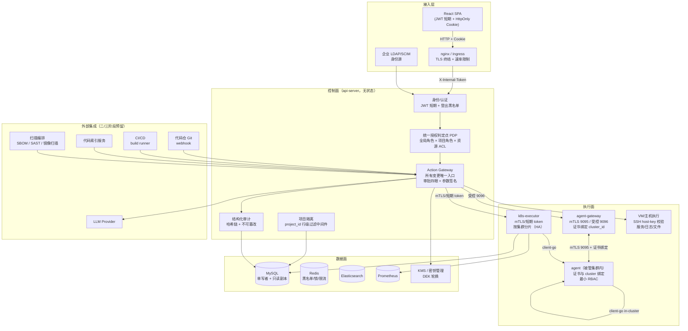

# 21 · 目标架构（Target Architecture）

> 审计对象：`/Users/wolf/Documents/project/autohealops`　审计时点：2026-11-27
> 上游输入：`docs/architecture/audit/01~17`、`20-risk-priorities.md`
> 本文件只做目标架构设计（只写本文档，不改代码/配置/依赖，不连生产，不做 git 写操作）。
> 结论可回溯到原报告编号；所有「现状」均来自 01~17 号报告证据。

---

## 1. 目标架构原则（10 条以内）

1. **控制面 / 执行面分离**：api-server 是唯一控制面（认证/授权/审批/审计的唯一判定点）；executor 与 agent 是执行面，只接受控制面下发的、已授权且已签名的指令，自身不做业务授权。
2. **最小权限**：任何执行都携带「谁 + 哪个项目 + 哪个集群 + 哪个命名空间 + 哪个动作」的权限上下文，逐层收敛（用户 → 项目 → 集群 → 命名空间 → 资源/动作）。
3. **四眼审批**：申请人与审批人强制分离（`requested_by != approver`），高风险变更（破坏性/写/DDL）必须双人，无法自批、自加签、自转办（对应 APP-01/02/03、DB-02）。
4. **证据可追溯**：所有变更落结构化审计（who/action/target/params_hash/before-after/result），哈希链连续不可篡改；执行参数绑定审批单签名，改一个字节即失效（对应 EXE-18/23）。
5. **多租户隔离**：`project_id` 贯穿数据模型与查询，行级过滤在数据访问层统一强制，不靠每个路由手写（对应 ISO-09、K8S-08）。
6. **密钥分离与轮换**：用户身份密钥（JWT）、内部服务密钥（独立 token/mTLS）、数据加密密钥（DEK）三者彻底分离，均可轮换，拒绝复用（对应 AUTH-01/ARCH-09/SEC-04）。
7. **纵深防御**：网络层（NetworkPolicy/egress 白名单）+ 传输层（mTLS/TLS）+ 应用层（授权判定点）三层叠加，任何一层失效不导致整体沦陷（对应 K8S-04/SEC-01）。
8. **可扩展三阶段**：第一阶段「安全止血 + 单体模块化」，第二阶段「代码/CI 接入 + 发布」，第三阶段「扫描编排 + 供应链」，每阶段可独立交付、不互相阻塞（详见 22 号）。
9. **契约先行**：跨服务（api-server/executor/agent/ai）的接口与 schema 用 proto/response_model 契约约束，拒绝「JSON 旁路 + dict 透传」（对应 ARCH-11/12、MOD-03）。

---

## 2. 分层架构图（目标态）

> 关键变化 vs 现状（ARCH 报告）：①内部调用全部从「明文 + 复用 JWT 密钥」改为「mTLS/独立内部 token」；②新增 Action Gateway 作为所有变更唯一入口；③executor 从单副本改为按集群分片；④数据面收敛为「api-server 单写者 + executor 只读/受限写」；⑤预留二/三阶段接入点。

---

## 3. 关键设计决策（现状 → 目标 → 为什么）

### 3.1 身份：JWT 短期 + 内部服务独立密钥/mTLS + LDAP/SCIM
- **现状**：JWT 长期有效、缺 iss/aud/jti（AUTH-10）；内部令牌 `X-Internal-Token` 复用 JWT 签名密钥（AUTH-01/ARCH-09/SEC-04/PERM-13）；LDAP 登录绕过防爆破（AUTH-04）；默认密钥 change-me（AUTH-02）。
- **目标**：用户 JWT 短期（如 15min）+ refresh + HttpOnly Cookie（替代 localStorage，SEC-05）；内部服务改用独立 `INTERNAL_SERVICE_TOKEN`（每服务一钥、可轮换）或 mTLS；接入 LDAP/SCIM 做统一身份源，LDAP 登录纳入与本地一致的防爆破与限流。
- **为什么**：根除「内部令牌泄露 = 伪造任意用户」的同源风险（AUTH-01），并堵住 URL/localStorage 凭据泄露面。

### 3.2 授权：全局角色 + 项目角色 + 资源级 ACL，统一 PDP
- **现状**：角色硬编码字符串四元组、roles 表零调用方（AUTH-07）；鉴权散落各路由、`_deny_cluster` 语义混乱（namespace 空=任意 ns，K8S-02）；agent/executor 零校验（AGT-06）；impersonation 未接线、实际 cluster-admin 执行（AGT-07/K8S-11）。
- **目标**：统一 PDP（policy decision point）——每个请求在入口处解析为 `(user, project, cluster, namespace, action)` 五元组，由单一 policy 引擎判定；禁止各路由各写一套校验；agent/executor 侧只做「控制面已签名的指令」校验，不重复实现业务授权。
- **为什么**：当前「授权散落 + 语义不一致」是 K8S-02/ISO-02/K8S-10 等一系列越权的根因；统一 PDP 让「漏判」从概率事件变为可审计的单一事实点。

### 3.3 审批：统一 Action Gateway（所有变更唯一入口），审批单签名绑定参数，四眼
- **现状**：审批只覆盖 AI 计划链路，人工直改集群无审批（EXE-04）；审批权与操作权解耦（PERM-08）；自批/自加签/双人可同一人（DB-02/APP-01/APP-03）；plan_json 变更不可检测（EXE-23）。
- **目标**：所有「变更类」动作（K8s 写操作、DB 写、VM 操作、脚本任务、AI 建议执行、批量执行）统一走 Action Gateway；审批单对「目标 + 动作 + 参数哈希」签名，执行前校验签名与当前参数一致；强制四眼（`requested_by != approver` + 双人）。
- **为什么**：EXE-04/EXE-01/PERM-02 等「绕过审批」问题的本质是「没有唯一变更入口」；Action Gateway 把审批从「某个链路的可选步骤」升级为「所有变更的强制闸门」。

### 3.4 执行面：executor 只信控制面（mTLS + 短期 token），agent 证书与 cluster 绑定
- **现状**：9090 无鉴权 + reflection（EXE-03/SEC-02）；9096 无鉴权可签证书/下发任意 RPC（K8S-04/AGT-01/SEC-03）；agent 证书不与 cluster 绑定、吊销不回收（AGT-03）；agent ClusterRole `*/*`+impersonate（ARCH-13）。
- **目标**：executor 与 agent-gateway 全部强制 mTLS（或独立短期 token），仅信任 api-server 身份；agent 客户端证书 CN/SAN 绑定 cluster_id，注册时校验，吊销即踢线；agent ClusterRole 收敛到最小（按需 read/list + 必要的写，去 impersonate）。
- **为什么**：这三条裸奔通道是「绕过平台一切控制」的物理直连，影响面=所有被管集群 cluster-admin（20 号 P0-A/B/C）；证书绑定是堵隧道劫持（AGT-02）的关键一环。

### 3.5 多租户：project_id 贯穿数据模型 + 行级过滤中间件
- **现状**：数据模型缺 project_id，全局对象无法归属（ISO-09）；告警域/审批列表/统计/AI 日志检索无范围过滤（ISO-01/06/08、PERM-06、K8S-08）；多个 IDOR（ISO-05）。
- **目标**：所有多租户对象表加 `project_id` 外键；数据访问层加统一行级过滤中间件（ORM query 自动附加 `WHERE project_id IN (用户可见项目)`）；列表/聚合接口统一走该中间件。
- **为什么**：把「每个路由手写过滤」改为「中间件强制」，从机制上消除跨租户泄露（而不是靠开发记得写）。

### 3.6 AI：工具调用统一走 Action Gateway + 权限上下文 + 证据链落库
- **现状**：MCP tools/call 直接调 handler，绕过权限闸门（EXE-02/PERM-01/AI-01）；AI 深诊白名单放行 exec_in_pod 无审批（AI-02）；证据护栏可被自由文本绕过（AI-03）；read→operate 提权（PERM-09）。
- **目标**：AI/MCP 工具调用统一走 `execute_tool` 门面 → 携带当前用户权限上下文 → 写类工具经 Action Gateway 审批；AI 的每个「建议动作」连同证据链（引文/指标/日志）落库，作为审批依据。
- **为什么**：AI 是未来最高频的「自动执行」入口，若不收口到 Action Gateway，等于给 AI 开了一个绕过一切审批的后门。

### 3.7 审计：结构化审计（who/action/target/params_hash/result）+ 不可篡改
- **现状**：写操作审计覆盖率约 9%（PERM-10）；审计字段不足、哈希链断裂（EXE-17/18）；batch/dispatch/custom-tasks/MCP/资源变更不写审计（EXE-19）。
- **目标**：统一审计中间件：`who / when / action / target / params_hash / before / after / result / trace_id`，所有变更（含拒绝事件）必写；哈希链连续、拒绝类事件也留痕；审计存储只追加、定期快照 + 签名防篡改。
- **为什么**：对外的「全链路审计可追溯」承诺依赖它；也是四眼审批与合规的证据基础。

### 3.8 HA：控制面无状态 + leader 选举，执行面按集群分片
- **现状**：k8s-executor 单副本硬约束、agent-gateway 单副本 + RWO 卷（ARCH-05/06）；api-server 多副本后台循环重复执行（ARCH-03）；alerts 双写者（ARCH-04）。
- **目标**：api-server 无状态 + 后台循环走 leader 选举（单 leader 跑定时任务）；agent-gateway 拆为「无状态网关 + 独立 CA 服务」；executor 按集群分片（多副本各负责一组集群，去单点）；alerts 收敛为单写者。
- **为什么**：消除单点（当前单副本宕机 = 全集群失联），同时避免多副本重复执行造成的数据竞态（QUA-01/TST-01）。

### 3.9 二阶段预留：repo/CI/CD 接入点（webhook、build runner、代码索引服务）
- **现状**：完全未实现（K8S-13 灰度发布未实现，无代码仓/CI 接入）。
- **目标**：Action Gateway 侧预留标准接口：`git webhook`（代码事件）、`build runner`（CI 触发/回传构建结果）、`代码索引服务`（版本→代码定位）；发布动作同样走 Action Gateway 审批。
- **为什么**：第二阶段「代码仓接入 + 版本定位 + 灰度发布」依赖这些接入点；第一阶段只留接口与数据模型，不实现业务逻辑。

### 3.10 三阶段预留：scanner 编排（SBOM、SAST、镜像扫描）与修复建议隔离区
- **现状**：完全未实现。
- **目标**：预留「扫描任务编排」与「扫描结果/修复建议」的数据模型，扫描产物进入隔离区（quarantine），不直接进入执行链路；修复建议需人工/AI 复核后经 Action Gateway 执行。
- **为什么**：扫描是「只读 + 建议」性质，必须与「执行」隔离，避免扫描器误报直接触发破坏性变更。

---

## 4. 演进路径：单体模块化 → 服务拆分（不要求微服务化）

| 阶段 | 形态 | 关键动作 | 对应报告 |
|---|---|---|---|
| 现状 | 单体多进程（api-server 495 文件/8.8 万行） | api/67 路由 + services/114 模块 | 01/03 |
| 第一阶段（0–3 月） | **单体模块化** | 抽「授权 PDP」「Action Gateway」「审计中间件」「项目隔离中间件」为独立模块/包，但仍在 api-server 进程内 | 20 号 §5 |
| 第二阶段（3–9 月） | **受控拆分** | 仅拆「代码索引服务」「build runner 适配」为独立服务；核心控制面保持单服务 | — |
| 第三阶段（9–18 月） | **扫描侧拆分** | scanner 编排独立服务；仍不拆 api-server 本体 | — |

**先不拆什么（明确决策）**：
- **api-server 本体不拆微服务**：当前 88k 行的单体问题在于「模块边界不清」而非「必须拆进程」。第一阶段先做进程内模块化（PDP/Gateway/审计/隔离四件套），收益远高于拆分，风险远低于拆分。
- **executor 不拆成「每集群一进程」**：按集群分片（多副本）即可去单点，不必过度拆分。
- **不引入消息队列**：当前无 MQ（01 号 §1.5），第一/二阶段审批与执行链路用「数据库 + 后台 worker + 幂等键」即可满足，避免为「看起来更分布式」而引入 Kafka/RabbitMQ 的运维成本。

---

## 5. 不做什么（避免过度设计）

1. **不做统一身份平台（自建 IdP）**：接入现有 LDAP/SCIM，不自研 OIDC 服务器。
2. **不在一阶段上 KMS/HSM 硬件**：先用「独立密钥 + 轮换脚本 + 配置 fail-fast」止血，KMS 进三阶段（K8S-16/VM-08 收敛但不追求硬件级）。
3. **不把 agent 改成「纯被动」**：保留 push/pull 双模式，但统一能力与鉴权（ARCH-10），不重写隧道协议。
4. **不做微服务网格（Service Mesh）**：mTLS 用 gRPC 原生 + 显式拦截器即可，不上 Istio/Linkerd。
5. **不实现完整 RBAC 到 K8s 原生映射**：impersonation 只做「有限的关键写操作」映射，其余仍以平台 PDP 为准（避免 AGT-07 的「假接入」再次发生，也避免维护成本爆炸）。
6. **不做 AI 全自动执行**：三阶段内 AI 只输出「建议 + 证据」，执行一律经人审批，不设「AI 自动修复开关」。

---

*本文档与 20 号（风险排序）、22 号（路线图）配套使用；所有「现状」结论可回溯到 01~17 号报告原文编号。*
