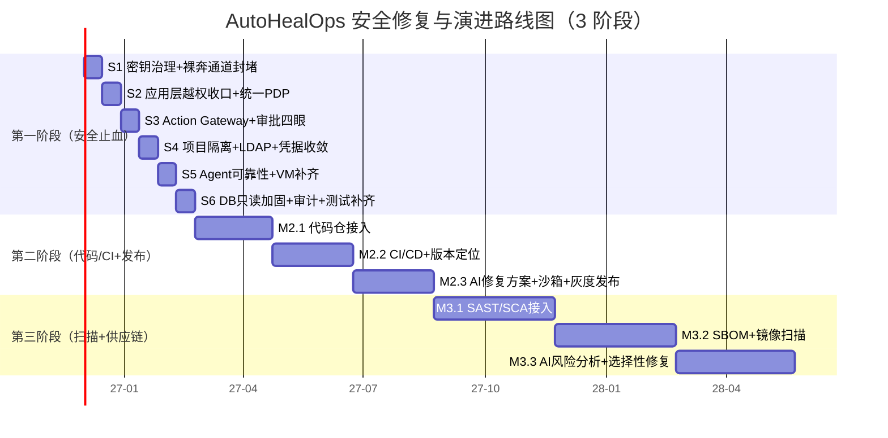

# 22 · 开发路线图（Development Roadmap）

> 审计对象：`/Users/wolf/Documents/project/autohealops`　审计时点：2026-11-27
> 上游输入：`docs/architecture/audit/01~17`、`20-risk-priorities.md`、`21-target-architecture.md`
> 本文件只做路线图规划（只写本文档，不改代码/配置/依赖，不连生产，不做 git 写操作）。
> 严格三阶段，二/三阶段功能不塞进第一阶段；结论可回溯到原报告编号。

---

## 0. 三阶段总览

| 阶段 | 时间 | 主题 | 核心目标 | 对应报告/问题 |
|---|---|---|---|---|
| 第一阶段 | 0–3 个月 | 安全止血 + 单体模块化 | P0 全清 + 关键 P1；Action Gateway + 四眼审批落地；项目隔离；LDAP；Agent 可靠性；VM 补齐；审计结构化；测试补齐 | 20 号 §5、§3-B1/B2 |
| 第二阶段 | 3–9 个月 | 代码/CI 接入 + 发布 | 代码仓接入、CI/CD 接入、版本→代码定位、AI 修复方案、沙箱测试、灰度发布 | K8S-13、21 号 §3.9 |
| 第三阶段 | 9–18 个月 | 扫描编排 + 供应链 | SAST/SCA/镜像扫描、SBOM、AI 风险分析、选择性修复 | 21 号 §3.10 |

> 纪律：**第一阶段不实现任何二/三阶段功能**（不接代码仓、不建 scanner、不做灰度发布）；二/三阶段只给「前置条件 + 里程碑 + 不做什么」，不展开 Sprint。

---

## 1. 第一阶段（0–3 个月）：安全止血 + 单体模块化

### 阶段目标（一句话）
按 20 号 §5 的依赖顺序清空全部 21 条 P0 与关键 P1，落地「Action Gateway + 四眼审批 + 项目隔离 + 统一 PDP + 审计中间件」五件套，补齐 Agent 可靠性与 VM 能力，建立可测数字的回归防线。

### Sprint 1（第 1–2 周）：密钥治理 + 裸奔通道封堵
- **目标**：根除共享密钥与三条未鉴权执行通道（20 号 §5 第 1、2 步）。
- **交付物**：
  - Settings fail-fast（拒绝 change-me/短密钥）+ install.sh 随机填充（AUTH-02/SEC-04）
  - 独立 `INTERNAL_SERVICE_TOKEN`/mTLS 体系，与 JWT 密钥彻底分离（AUTH-01/ARCH-09/PERM-13）
  - 9090/9096/9100 全部加 token/mTLS 拦截器 + 关 reflection + IssueClientCert 拆 admin-only + pull-token 强制非空（EXE-03/SEC-02、K8S-04/AGT-01/SEC-03、EXE-05）
  - compose 不发布 9090；NetworkPolicy 覆盖 executor/ai-service/agent-gateway/api-server
- **验收标准**：①无凭据 `grpcurl -plaintext` 打 9090/9096/9100 均 Unauthenticated；②`grpcurl list` 反射不返回服务列表；③用 `JWT_SECRET_KEY=change-me` 启动直接失败退出；④`X-Internal-Token` 与 JWT 签名密钥不再是同一字符串。
- **风险**：内部调用点散落（26 个后台协程 + 多方回调），改 token 需全量回归；agent 存量集群需滚动重发证书。

### Sprint 2（第 3–4 周）：应用层越权执行收口 + 统一 PDP
- **目标**：堵住「仅登录即可执行写操作」的应用层入口，建统一授权判定点（20 号 §5 第 3 步 + 21 号 §3.2）。
- **交付物**：
  - MCP tools/call 改走 `execute_tool` 门面 + `check_cluster_permission`，写类工具默认禁用（EXE-02/PERM-01/AI-01）
  - custom-tasks 创建/执行前授权校验 + script 类型默认关闭（PERM-02/EXE-06）
  - /batch 审批校验 + 逐集群授权 + 审计（EXE-01）
  - PDP 模块：统一 `(user, project, cluster, namespace, action)` 判定；拆分 cluster_access 与 namespace_access（K8S-02/ISO-02）
- **验收标准**：①viewer 调 MCP exec_in_pod → 403 且无命令输出；②operator 建指向无授权集群的 script 任务 → 403；③只授权 ns-a 的 viewer 调 `/pods?namespace=` 只返回 ns-a；④PDP 判定日志对每个请求输出五元组。
- **风险**：MCP 语义变化可能影响已有外部 AI 客户端（需兼容开关）；PDP 替换散落 `_deny_cluster` 易漏改。

### Sprint 3（第 5–6 周）：Action Gateway + 审批四眼落地
- **目标**：所有变更唯一入口 + 强制四眼 + 参数签名（21 号 §3.3）。
- **交付物**：
  - Action Gateway 统一拦截 K8s 写操作/DB 写/VM 操作/脚本任务/批量执行（EXE-04/EXE-07/K8S-06）
  - 四眼：`requested_by != approver`、双人、禁自加签/自转办（DB-02/APP-01/APP-03/PERM-07/APP-11）
  - 审批单绑定参数哈希（params_hash），执行前校验（EXE-23）
  - 审批超时终态 + approvers 空数据拒绝（APP-06/07/12）
- **验收标准**：①同一账号提单+审批自己 → 403；②改 plan_json 一个字节后审批通过 → 执行被拒；③operator 直 DELETE workload 被 Action Gateway 拦截要求审批（或二次确认）；④审批单落 params_hash 且执行校验通过/失败可数字统计。
- **风险**：存量审批数据/流程迁移量大（123 个 alembic 版本）；高风险动词清单需产品确认边界。

### Sprint 4（第 7–8 周）：项目隔离 + LDAP + 凭据收敛
- **目标**：项目隔离落地、身份源接入、关键凭据漏洞收敛（20 号 §3-B2 + 21 号 §3.1/3.5）。
- **交付物**：
  - project_id 贯穿数据模型 + 行级过滤中间件（ISO-09/ISO-08）
  - 告警域/审批列表/统计/AI 日志检索范围过滤（ISO-01/06、PERM-06、K8S-08）
  - IDOR 修复：执行/回滚/项目详情/DB 端点归属校验（ISO-03/04/05、PERM-05）
  - LDAP 接入 + 防爆破与限流统一（AUTH-04/SEC-07）
  - 凭据收敛：Secret 读取单独鉴权+脱敏、registry host 白名单、SFTP /home 白名单收敛、update_host 凭据校验（K8S-03、SEC-01、VM-01/02、K8S-01/PERM-04）
- **验收标准**：①A 项目用户读不到 B 项目告警/审批/日志/执行输出（构造双项目用例）；②viewer 读 Secret → 只返回 key+长度；③image=非白名单域 → 400 且不发 Basic 头；④LDAP 连续错密码触发与本地一致的限流。
- **风险**：project_id 迁移要回填历史数据归属（需产品给默认归属规则）；行级过滤中间件可能误伤合法跨项目查询（需白名单）。

### Sprint 5（第 9–10 周）：Agent 可靠性 + VM 补齐
- **目标**：Agent 幂等/取消/心跳/证书绑定，VM 服务/日志/文件能力补齐（20 号 §3-B3 + 21 号 §3.4）。
- **交付物**：
  - agent 证书绑定 cluster_id + 吊销踢线 + 断线状态机恢复（AGT-03/AGT-14）
  - 平台超时取消 agent 侧执行 + 请求幂等键 + 队列有界（AGT-04/AGT-05）
  - agent ClusterRole 收敛（去 impersonate，最小写权限）（ARCH-13/AGT-07）
  - VM：服务管理/日志查询/非交互命令执行（VM-11）；SSH host-key 校验（VM-06）
  - 9099 日志流鉴权 + heapdump 移除/加权限（K8S-07/SEC-06/ARCH-07）
- **验收标准**：①吊销证书后在线 agent 连接被踢且不可重连；②平台超时 30s 后 agent 侧执行被取消（构造长任务）；③VM 页面可查服务/日志/执行命令；④无凭据访问 9099 日志流 → 401。
- **风险**：agent 侧取消依赖隧道协议扩展，存量 agent 需版本兼容；VM 能力涉及被管主机安全边界（SSH 命令执行需审批接入）。

### Sprint 6（第 11–12 周）：DB 只读加固 + 审计结构化 + 测试补齐
- **目标**：数据库读写边界加固、审计闭环、关键链路测试（20 号 §3-B3 + 21 号 §3.7）。
- **交付物**：
  - DB：kind 服务端 classify、只读数据库级保障、自批禁止、备份/下载/DDL/定时外带审批（DB-01/02/03/04/05/06/07/10）
  - 审计中间件：who/action/target/params_hash/result 全字段 + 哈希链连续 + 拒绝事件留痕（EXE-17/18/19、DB-09、PERM-10）
  - 测试：审批→执行链路、权限矩阵、危险动作（scale/delete/rollback/exec）、审计哈希链（TST-01/02/03/07）
  - CI 跑 go test + Python 测试 + 覆盖率门槛（TST-03/04）
- **验收标准**：①`kind=query + delete` 被拒；②`WITH...DELETE`/`SELECT...FOR UPDATE` 被拒且会话只读已生效；③写操作审计覆盖率从 9% 提到 ≥80%；④新增测试全绿且 CI 强制 go test；⑤审批→执行并发场景无重复执行。
- **风险**：审计中间件改造涉及 285 个写路由（PERM-10），需分模块分批接入；哈希链修复需回填历史断裂点。

---

## 2. 第二阶段（3–9 个月）：代码/CI 接入 + 发布

### 前置条件（第一阶段必须达成，否则不进入）
1. P0 全部关闭、P1 关闭率 ≥80%（按 20 号总表核对）。
2. Action Gateway + 四眼审批 + 统一 PDP 在生产稳定运行 ≥1 个月，无「绕过审批」回归。
3. 审计覆盖率 ≥80%，哈希链连续可验证。
4. 项目隔离行级过滤中间件全量生效，无双租户泄露用例。
5. Agent 证书绑定 + 取消/幂等机制稳定，agent 版本统一。

### 里程碑（3 个）
- **M2.1（3–5 月）代码仓接入**：Git webhook 接入、代码仓/分支/commit 模型、变更事件进入 Action Gateway 审计流；**不实现** CI 触发执行。
- **M2.2（5–7 月）CI/CD 接入 + 版本→代码定位**：build runner 适配、构建结果回传、版本→commit→代码文件定位服务；**不实现**自动修复。
- **M2.3（7–9 月）AI 修复方案 + 沙箱测试 + 灰度发布**：AI 输出「带证据的修复建议」（经审批）、沙箱环境验证修复、灰度发布（金丝雀/流量切分，K8S-13）；**不实现**全自动执行。

### 不做什么
- 不接入「AI 自动修复开关」（执行一律经人审批，21 号 §5.6）。
- 不做多代码仓/多 CI 系统的完整矩阵（先支持单一 Git + 单一 CI）。
- 不建独立「代码索引集群」（单机倒排即可，避免过度设计）。

---

## 3. 第三阶段（9–18 个月）：扫描编排 + 供应链

### 前置条件（第二阶段必须达成）
1. 代码仓 + CI/CD 接入稳定，版本→代码定位可用。
2. 灰度发布跑通并回滚演练通过。
3. 沙箱测试环境隔离验证过（修复方案不会污染生产）。

### 里程碑（3 个）
- **M3.1（9–12 月）SAST/SCA 接入**：静态代码扫描 + 依赖漏洞扫描，结果入隔离区（quarantine），只读不执行。
- **M3.2（12–15 月）SBOM + 镜像扫描**：SBOM 生成/台账、镜像层扫描、与发布流水线挂钩（阻断门禁）。
- **M3.3（15–18 月）AI 风险分析 + 选择性修复**：AI 分析扫描结果生成风险报告，选择性修复建议经 Action Gateway 审批执行。

### 不做什么
- 不接入「扫描发现即自动修复」（扫描产物与执行隔离，21 号 §3.10）。
- 不做自研扫描引擎（优先集成开源 SBOM/SAST/镜像扫描器，遵循「现有方案优先」原则）。
- 不做全量 SBOM 合规认证（先做台账 + 门禁，认证评估另行立项）。

---

## 4. 资源估算（1 后端 + 1 前端 + 1 SRE）

> 口径：1 人日 ≈ 8 小时有效开发。仅覆盖本路线图直接工作量，不含日常运维/线上救火。
> 假设：①团队成员熟悉 Go + Python(FastAPI) + React；②已有 01~17 号审计报告作为需求基线；③无额外招聘；④历史数据迁移由后端兼做。

| 阶段 | 后端（人日） | 前端（人日） | SRE（人日） | 合计（人日） | 关键假设 |
|---|---:|---:|---:|---:|---|
| 第一阶段（6 Sprint） | 45–60 | 15–25 | 12–18 | **72–103** | 后端主导 PDP/Gateway/审计/隔离；前端主要改权限入口与审批流；SRE 做密钥轮换/NetworkPolicy/agent 重发 |
| 第二阶段（3 里程碑） | 40–55 | 20–30 | 15–20 | **75–105** | 后端做 webhook/runner/定位服务；前端做发布与灰度界面；SRE 搭 CI 接入与沙箱 |
| 第三阶段（3 里程碑） | 35–50 | 15–25 | 20–30 | **70–105** | 后端做扫描编排与隔离区；前端做风险报告界面；SRE 集成扫描器与 SBOM 门禁 |
| **合计** | **120–165** | **50–80** | **47–68** | **217–313** | — |

**换算**：按 1 人年 ≈ 220 人日计，三人团队第一阶段约需 **5–7 个月日历**（含并行损耗与需求往返），故本路线图时间按「3 个月」是激进口径，实际以 P0 清空为硬性完成线、其余 P1 允许顺延。

---

## 5. 甘特图（3 阶段，6+3+3 里程碑）

---

## 6. 「先修 vs 先建」取舍说明

| 议题 | 结论 | 理由（回溯） |
|---|---|---|
| 先修 P0 漏洞 vs 先建新架构 | **先修 P0**，且按「换密钥→堵裸奔→收应用层」顺序 | 未鉴权通道仍开放时，新架构的接口级防御无意义（20 号 §5） |
| 先建 Action Gateway vs 先补各路由审批 | **先建 Gateway（统一入口）再逐个接入** | 散落审批是「概率性漏判」根因；唯一入口才能根治（EXE-04/EXE-01） |
| 先做项目隔离 vs 先做 LDAP | **并行**，项目隔离略优先 | 隔离是「多租户」承诺的基础（ISO-09）；LDAP 是身份源，二者无强依赖 |
| 先修 Secret 明文 vs 先修 DB 绕过 | **同批（Sprint 4）**，Secret 明文更急 | 两者都可 72h 完成，Secret 直接导致凭据泄露（K8S-03） |
| 先补测试 vs 先补功能 | **先补「危险动作 + 审批 + 权限」测试，随 Sprint 走** | 无测试的修复不可验收；但测试须与修复同 Sprint 落地（TST-01/02/03） |
| 先做 Agent 可靠性 vs 先做 VM 补齐 | **先 Agent 可靠性** | Agent 是不可见执行面的信任基础（AGT-03/04）；VM 是能力补齐 |
| 二阶段功能（代码仓/灰度）是否提前 | **不提前** | 违反「三阶段纪律」，且前置条件（P0 清空 + Gateway 稳定）未达成前无意义（K8S-13） |

**一句话总结**：先「止血」（密钥 + 裸奔通道 + 越权入口，24h~1 周）→ 再「立规矩」（Action Gateway + 四眼 + 隔离 + 审计，1~3 月）→ 才「求发展」（代码接入 → 扫描，3~18 月）。

---

*本文档与 20 号（风险排序）、21 号（目标架构）配套使用；所有结论可回溯到 01~17 号报告原文编号。*
